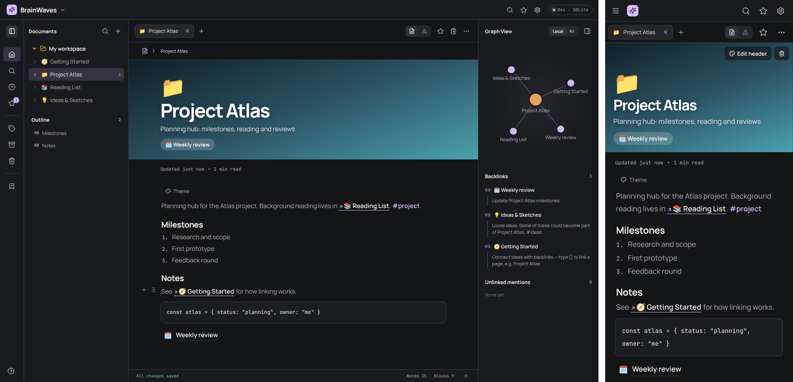

# BrainWaves

**A local-first workspace for notes, databases and canvases.**

You write in pages made of blocks. Pages link to each other, can carry properties, and can become databases with table, board and gallery views. Any page can also open as a canvas. Your data lives in one SQLite file on your computer, or on your own server, never in someone else's cloud. Modules add whole workflows on top: following a course, or running a Dungeons & Dragons campaign with live battle maps.



## What it does

**Writing**
- Block editor: the `/` menu, Markdown shortcuts and drag handles.
- Links: `[[page links]]`, `((block references))`, backlinks and a graph.
- Content blocks: tables, columns, callouts with your own colours, images, code.
- Page headers with pictures or gradients, breadcrumbs and sub-page navigation.
- Page properties, shown in a pop-up or under the title.
- Templates with fields to fill in and sub-pages: a form, or `{{template: …}}` typed in a page.
- Formulas: live values in your text, such as `{{= [[Books]].count(Read = true)}}`.

**Organising**
- Databases: typed columns, relations and rollups; table, board and gallery views with filters, sorting and grouping.
- Rows are pages: any page can become a database, and a database can be shown on other pages.
- Maps of content: lists of pages that keep themselves up to date.
- Tags (`#tag`, or a Tags property), quick find, full-text search.

**Canvas:** an edgeless board with notes, shapes, connectors, frames and pictures. It has a side panel, smart guides, layers, groups and presenting. A page can be split into parts and laid out freely.

**Everywhere**
- **Desktop app** (Windows, macOS, Linux; built with Tauri).
- **Self-hosted web app** with your own login, installable on Android.
- **Two-way sync** between the two, which works offline.
- A theme editor, and a theme per page.

**Extending**
- **Widgets:** small HTML apps connected to your databases.
- **Modules:** larger add-ons with their own data and blocks.
- **Built-in modules:** Courses, and Dungeons & Dragons with a compendium, campaigns, character sheets, world maps and a battle-map table for players.
- **Burrow:** the [Burrow](https://github.com/RayDevXyz/burrow) bookmark manager is built in.

## Getting started

**Windows, from scratch:** double-click `scripts\install-windows.cmd`. It installs whatever is missing (Git, the C++ build tools, WebView2, Rust, Node.js and pnpm), installs the project's packages and compiles it once.

| Option | What it does |
|---|---|
| `-Run` | starts the app afterwards |
| `-Build` | builds the installer |
| `-Check` | runs the tests |

```powershell
scripts\install-windows.cmd -Run
```

**If you already have the tools** (Rust, Node.js 20+ and pnpm):

```bash
pnpm install
cd apps/desktop && pnpm tauri dev          # the desktop app
cargo test --workspace && pnpm -r test     # the tests
```

`apps/desktop/README.md` explains running the app in a browser during development.

**On your own server:** a Docker image (`ghcr.io/raydevxyz/nmuch`) for Cosmos Cloud or Docker Compose. See [docs/guide/hosting.md](docs/guide/hosting.md).

## Documentation

Everything is in [docs/](docs/README.md): guides for each feature, how to write widgets and modules, and the design notes.

## Repository layout

```
apps/desktop         the app: React + TypeScript UI, and the Tauri desktop shell (src-tauri)
apps/table           the players' page of the battle-map table
packages/editor      @brainwaves/editor: the Tiptap block editor (schema, nodes, menus)
crates/bw-core       the Rust core: pages as Yjs documents, an SQLite update log, a rebuildable index
crates/bw-api        the commands the UI calls, shared by every host
crates/bw-server     BrainWaves as a hosted web app (login, API tokens, sync)
crates/bw-devserver  the core over HTTP, to run the UI in a browser during development
crates/bw-table      the battle-map table server
deploy/              Docker Compose and Cosmos Cloud setups
integrations/burrow  the Burrow side of the integration
docs/                guides, developer docs and design notes
```
