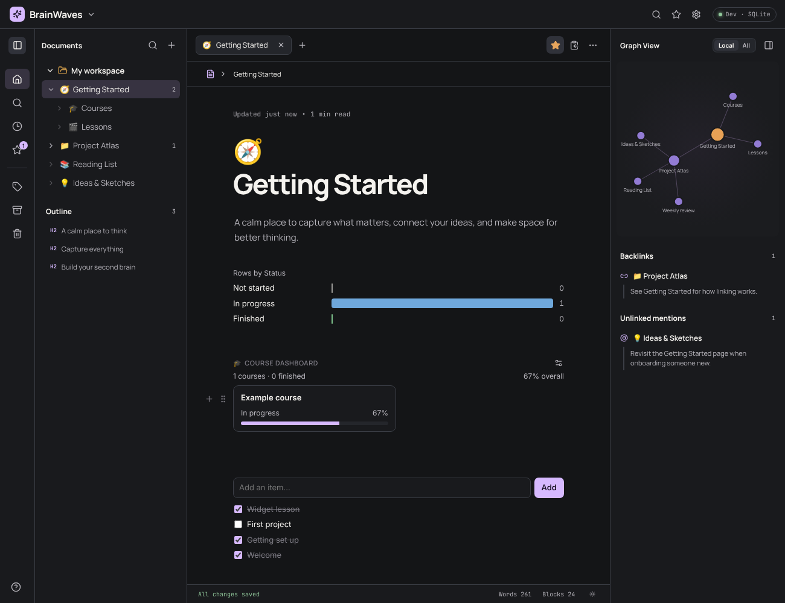
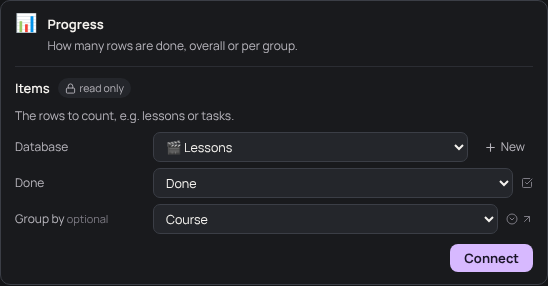
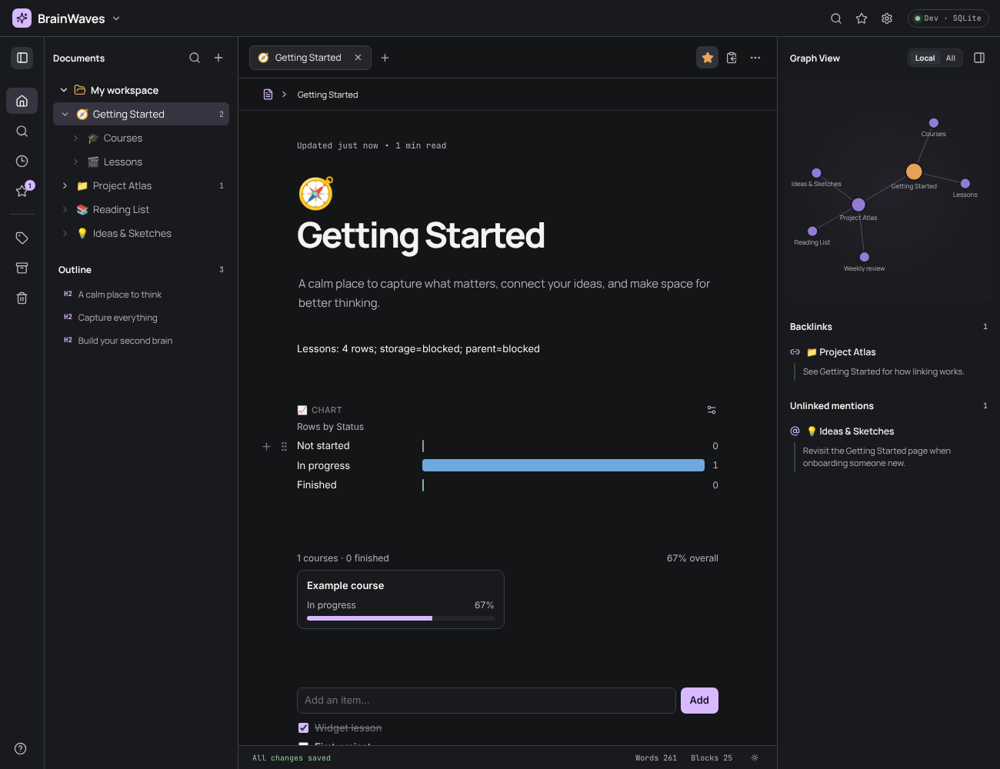

# Phase 4: Widgets and the widget data API

**Status:** working end to end in the browser against the real Rust core.

| Check | Result |
|---|---|
| Rust tests | 32 pass, including 5 new widget access tests |
| JS contract tests | 3 pass, now including the widget block |
| Typecheck and clippy | Clean |
| Browser run | Scripted; the only failed request was the deliberately forbidden write |

**Branch:** `claude/dazzling-einstein-0r1sxx`.
**Builds on:** [Phase 3](phase-03-databases.md).
**Plan:** step 4 of the build order in [architecture.md](architecture.md).

**Want to write a widget?** [widgets.md](../develop/widgets.md) is the authoring guide.



*One page with three widgets: a chart of courses by status, the course dashboard, and quick add.
All are connected to the Course tracker databases from phase 3. Adding a lesson in quick add
updates the dashboard, the progress widget and the Lessons table at once.*

---

## 1. What this phase had to deliver

From the architecture doc:

> **Widget API is reactive.** `subscribe(query, cb)` and `mutate(rowId, patch)`. If widget A
> writes table X, widget B, which reads X, updates instantly with no direct wiring between them.
>
> **Widgets declare access.** Each widget lists which tables it reads and writes.

So, in practice:

1. **A widget is a small app inside a page.** It reads and writes databases.
2. **It's live.** A change anywhere shows up everywhere.
3. **It only gets what it declared and you allowed.** This matters as soon as widgets come from
   files other people wrote.

All three work. Section 7 shows the tests.

---

## 2. The model in one picture

```
 Widget definition (installed once)            Widget instance (a block in a page)
 ───────────────────────────────────           ─────────────────────────────────────
 manifest:                                      widget:   "brainwaves.progress"
   slots:                                       bindings: { items: { databaseId: <Lessons>,
     items: read                                                     fields: { done: <Done col>,
       fields: done  (checkbox)                                                group: <Course col> } } }
               group (select|relation, opt.)    settings: { label: "…" }       ← widget's own options
 html: one file, the whole widget
```

- **The definition** says what the widget *needs*, by type: "a database with a checkbox column".
- **The instance** says what *you gave it*: this database, and this column for that need.
  Bindings and settings live on the block, in the page's Y.Doc, so they sync, undo and travel
  with the page like any other content.

Definitions are stored in a new `widget_defs` table next to the truth tables. They are app data,
not page data: they're not in the yrs log and the index doesn't project them.

---

## 3. Where the access check lives (and why there)

```
 iframe (sandbox)          host (React)                     Rust core
 ────────────────          ─────────────                    ─────────
 bw.mutate('items',  ──►  knows which <iframe> sent it  ──►  widgetMutate(pageId, blockId,
   row, {done:true})       (event.source), adds             slot, row, patch)
                           pageId + blockId                  1. read the block from the page
                                                             2. load its manifest
                                                             3. slot exists? write access?
                                                             4. row in the bound database?
                                                             5. every key a bound field of an
                                                                allowed type?
                                                             6. map keys → column ids, set_value
```

**The core makes the decision.** It reads the bindings from the stored page, not from the
request, so:
- **A widget can't widen its access.** It never names a database or column. It only says
  "slot `items`, field `done`".
- **A buggy host can't widen it either.** The host only says *which block* is calling. The core
  works out the rest.
- **The widget only sees its own names.** Results come back keyed by the widget's field keys. Column ids
  and unbound columns never leave the core.

The browser adds the second wall: the sandbox.
- **`sandbox="allow-scripts"`, without `allow-same-origin`.** The frame gets an opaque origin, so
  it can't reach the app's DOM, storage or Tauri IPC.
- **A Content-Security-Policy at the top of the document.** It blocks all network access.

The only way out is `postMessage` to the host. The host only answers the frame it created. It
identifies that frame by its `contentWindow`; the origin isn't usable, because a sandboxed frame's
origin is `"null"`.

---

## 4. Live updates

Nothing new was needed. This is the event bus from phase 1 doing its job:

1. A widget write goes through the same `set_value` / `create_row` path as the database UI.
2. That commits a yrs update.
3. The core emits `pageChanged` / `pageCreated`.
4. The host re-runs every subscription of every mounted widget (debounced by 80 ms) and pushes
   the new results into the frames.

The database tables already listen to the same events, so quick add → Lessons table → progress
widget all update together.

One subtle issue came up in testing:
- **The problem:** when you click **Connect**, the bindings are written into the page by the
  editor. The core only sees them after the page sync's 120 ms debounce. So the widget's first
  query could be refused ("slot not connected yet").
- **The fix:** every widget call first flushes pending page edits (`flushAll()`). The core then
  always sees the bindings the user just set.

---

## 5. What you can do in the app

**Add a widget.**
1. Type `/` and the widget's name, for example `/progress`.
2. A setup screen asks for a database per slot and a column per field.
3. Only columns of fitting types are offered. Obvious ones are picked for you.
4. **+ New** creates a database with exactly the columns the widget needs.



**Change the connection later.** Hover a widget, then click the sliders icon in its top-right
corner.

**Manage widgets.** Open **Settings (⚙) → Widgets…**. It lists what's installed. **Install from
file…** adds an `.html` widget. Custom widgets can be uninstalled; blocks that use them stay in
their pages and say the widget isn't installed.



*Top: the custom test widget from section 7, installed from an `.html` file. It reports that storage and the parent page are blocked. Below it: the built-in Chart and Course dashboard.*

**The built-in widgets.** They ship with the app as HTML files and are installed at startup.
They're reinstalled when their version changes.

| Widget | Slot | What it does |
|---|---|---|
| **Progress** | read: `done` (checkbox), `group` (select/relation, optional) | "3 / 4 · 75%" plus a bar per group (per course for lessons). |
| **Quick add** | write: `done` (checkbox, optional) | An input that adds rows, plus the latest rows with tick boxes. Click a title to open the row. |
| **Chart** | read: `category` (select/multi/checkbox), `value` (number, optional) | Rows (or the sum of `value`) per option, in the option's color. |
| **Course dashboard** | read: `progress` (rollup/number), `status` (select, optional) | A card per course with its progress, plus totals. Click to open. |

---

## 6. What changed, file by file

**Core (`crates/bw-core`)**
- `src/widgets.rs` (new). Manifest types and validation, plus install/list/remove of
  definitions. Also the three checked calls: `widget_query`, `widget_mutate` and
  `widget_create_row`.
- `src/store.rs`: the `widget_defs` table.
- `src/error.rs`: `Error::Forbidden`.
- `src/doc.rs`: `NewBlock::widget(...)`. The indexer records a *ref* from a widget block to each
  database it's bound to, so a database's backlinks show the pages that use it in widgets.
- `tests/widgets.rs` (new): 5 tests (see below).

**API (`crates/bw-api`)**
- Definitions: `listWidgets`, `widgetDef`, `installWidget`, `removeWidget`.
- Instance calls: `widgetQuery`, `widgetMutate`, `widgetCreateRow`.

**Editor (`packages/editor`)**
- `nodes/widget.tsx` (new): the `widget` block. It's an atom with attrs `widget`, `bindings` and
  `settings`, and the host renders it.
- **Bindings and settings are JSON *strings*.** y-tiptap compares attribute values by reference, so
  an object attribute would look changed on every sync.
- `/` menu extras: a widget whose *name* matches is now listed before one that only matches by
  keyword.
- Database and widget blocks now carry `data-id`, so "jump to block" can find them.

**App (`apps/desktop/src/widgets/`, new)**
- `runtime.ts`: the `bw` client injected into each frame, the CSP, the theme variables, and
  reading a manifest out of an HTML file.
- `WidgetBlock.tsx`: the iframe and the postMessage bridge (calls, subscriptions, resize,
  settings, theme).
- `BindingSetup.tsx`: the setup screen.
- `WidgetsDialog.tsx`: Settings → Widgets.
- `builtin/*.html` + `builtin.ts`: the four built-ins and their registration at startup.

---

## 7. Tests

**Rust (`crates/bw-core/tests/widgets.rs`)**

| Test | What it proves |
|---|---|
| `a_widget_sees_only_its_bound_fields` | The results hold the title plus the bound fields, under the widget's keys. Other columns don't appear at all. |
| `writes_need_a_write_slot_bound_fields_and_rows_of_the_bound_database` | Each of these is refused: a read slot, an unbound field, and a row from another database. |
| `bindings_are_checked_against_the_manifest` | A column of the wrong type is refused, and so is a missing required field. |
| `definitions_are_validated_and_listed_without_code` | Bad ids and keys are rejected, and listings leave out the HTML. |
| `widget_blocks_link_to_their_databases` | The index has a ref from the widget block to its database. |

The editor ↔ core contract fixtures now include a widget block. Both sides agree on its
attributes and refs.

**Browser (scripted, against the dev server)**
1. `/course` → Course tracker. `/progress` → bound to Lessons; "Done" was auto-picked.
   Result: **2 / 3 · 67%**.
2. `/quick` → bound to Lessons. Added "Widget lesson": it appeared in quick add, the Lessons table
   and the progress widget (**2 / 4 · 50%**). Ticked it: **3 / 4 · 75%**.
3. `/dashboard` → Courses: "Example course · In progress · 67%". `/chart` → Courses by Status.
4. **Forbidden calls**, made from inside a frame and straight to the API as a hostile widget would.
   All were refused:
   - `createRow` from the read-only Progress widget → `slot "items" is read-only`.
   - Sorting by an unbound column → `"minutes" is not a field of slot "items"`.
   - A made-up block id → `there is no widget nope on this page`.
5. **A custom widget installed from a file** via Settings → Widgets. It counted Lessons rows, and
   reported that `localStorage`, `parent.document` and `fetch` were all **blocked**.

---

## 8. Limits and next steps

- **Errors aren't shown in the page.** A widget sees refused calls as errors, but the page shows
  nothing; the widget has to display them.
- **Re-querying is coarse.** Every committed change re-runs every subscription. That's fine at
  this size. Later the core can say *which* databases changed, so only affected widgets re-query.
- **No automations yet.** The architecture doc's "imperative" side ("when a row is added in X,
  create a row in Y") belongs with modules.
- **Fonts.** Widgets use the system font stack. The app's own font files can't load in the
  network-less sandbox.
