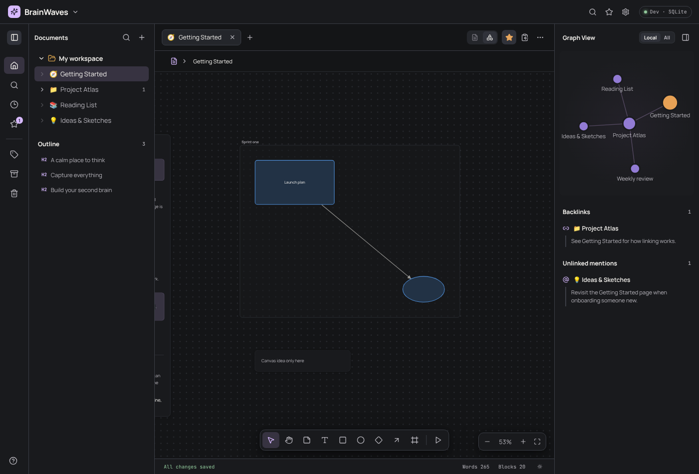

# Phase 5: Edgeless mode (the canvas)

**Status:** working end to end in the browser against the real Rust core.

| Check | Result |
|---|---|
| Rust tests | 36 pass, including 4 new edgeless tests |
| JS contract tests | 3 pass |
| Typecheck and clippy | Clean |
| Browser run | Scripted run, no console errors |

**Branch:** `claude/dazzling-einstein-0r1sxx`.
**Builds on:** [Phase 4](phase-04-widgets.md).
**Plan:** step 5 of the build order in [architecture.md](architecture.md).



*The "Getting Started" page in canvas mode:*
- *The page's note (left edge) holds the whole document.*
- *The frame "Sprint one" holds a rectangle with text and an ellipse, joined by a connector.*
- *Below the frame is a canvas-only note, drawn with a dashed border.*

---

## 1. What you decided

| Question | Your answer |
|---|---|
| How to build the canvas | **Build our own.** No tldraw: no license, and notes stay full Tiptap editors. |
| Tools for this phase | **Shapes + text, connectors, frames.** No freehand pen yet. |
| Doc mode vs canvas | **The same notes in both views.** A note can be marked *canvas only*. |

---

## 2. The model: one page, two views

The page model was ready for this since phase 1. A page's Y.Doc already had `notes` with an
`xywh` slot, and a reserved `surface` map. This phase fills them in:

```
Y.Doc (one per page)
├── notes:   note_id → { order, content, xywh: [x,y,w,h], display: "both" | "edgeless" }
│              doc mode:   notes in `order`, skipping display = "edgeless"
│              canvas:     every note, placed at `xywh`
└── surface: element_id → Y.Map { id, type, index, …fields }
               type = shape | text | connector | frame
```

**There is one source of truth.** Writing in a note on the canvas is writing in the document; the
two are the same `Y.XmlFragment`. Switching views is instant and loses nothing.

**Each element is a `Y.Map` with one entry per field**, not one JSON value. So if one person
moves a shape while another renames it, both changes survive. The test
`concurrent_edits_to_different_fields_merge` proves this with two clients editing the same shape.

The element fields:

| Type | Fields |
|---|---|
| `shape` | `xywh`, `shape` (rect / ellipse / diamond), `fill`, `stroke`, `text` |
| `text` | `xywh`, `text`, `fontSize`, `color` |
| `connector` | `source` and `target`. Each is `{ id }` (a note or element) or `{ point: [x, y] }`. Plus a `text` label and `stroke`. |
| `frame` | `xywh`, `text` (its title), `fill` |

How the fields are stored:
- **`index` is a fractional key.** It sets the stacking order and the order frames are presented in.
- **Colors are names** (`blue`, `green`, …), not hex values, so they look right in both the light
  and dark theme.
- **Unknown fields are kept.** A newer version can add fields without an older one dropping them.

---

## 3. What the core does

The core is still the only writer. The canvas edits the page's Y.Doc like the editor does, and
the core:

1. **Validates** elements written through the core: a known `type`, a valid `xywh`, and connector
   ends. Updates from clients are read leniently: anything malformed is skipped, not fatal.
2. **Indexes** each element as a block with flavour `surface.<type>` and its text. **Search finds
   words written on the canvas.** Opening such a result switches the page to the canvas, zooms to
   the item and selects it.
3. **Keeps it disposable.** The index version is now 4, so existing databases rebuild once. The
   rebuild test checks that rebuilding gives identical rows.

New in `BlockTxn` (for modules later, e.g. a Course module laying out a board):
- `set_element`
- `update_element`
- `remove_element`
- `set_note_layout`

---

## 4. Using the canvas

The user guide is [guide/canvas.md](../guide/canvas.md).

## 5. How it's built (`apps/desktop/src/edgeless/`)

- **`model.ts`** reads and writes the surface and note layouts in the Y.Doc.
  - Every canvas write is made with the origin `CANVAS`, so a `Y.UndoManager` scoped to `surface`
    and `notes` undoes exactly the canvas's own changes.
  - It also holds the geometry. `edgePoint` stops a connector at the outline of a rectangle,
    ellipse or diamond, not at its center.
- **`Canvas.tsx`** draws everything and handles pointer gestures and the keyboard.
  - **One CSS transform** (`scale(z) translate(-x, -y)`) moves the whole world. Notes are real
    Tiptap editors inside it, so editing, slash menus, links and databases all work on the canvas.
  - **The layers are:** frames at the back, then shapes, text, pictures, pins and connectors
    in their own stacking order (each element's fractional `index`, which **Position** and
    **Layers** change), then notes in front. On a battle map, the map picture, the grid and fog,
    and the tokens keep their own places. The selection, guides and bars are drawn in screen
    space on top.
  - **Hit testing uses the DOM.** Every item carries `data-cid`. Because the canvas captures the
    pointer during a drag, clicks and double-clicks look up what's under the pointer instead of
    trusting the event's target.
  - **Notes grow with their text.** The stored height is a minimum; the real height is measured
    with a `ResizeObserver`, so connectors and selection boxes fit the note as it grows.
- **`SidePanel.tsx`** is the side panel: the presets it adds, uploads, and Layers.
- **`ContextBar.tsx`** is the bar at the top that follows the selection.
- **`geometry.ts`** has the editing geometry: the bounds of turned items, resizing a turned
  item in its own frame, angles, smart-guide snapping, aligning and spacing.
- **`chrome.tsx`** holds the zoom bar (undo/redo, a zoom slider, fit, present).
- **New element fields** (all optional, so older pages are unchanged and older clients keep
  them, see `surface.rs`): `rotate` (degrees), `opacity`, `locked`, `visible` (false: hidden),
  `group` (a shared id), and for text and shapes `fontFamily`, `bold`, `italic`, `underline`,
  `align`; shapes add `strokeWidth` and `color` (the text on them). Colors may be any `#hex`
  as well as the named ones, and a fill may be `none`.

**Changes outside the canvas:**
- `Editor.tsx` renders the canvas in canvas mode. In doc mode it skips canvas-only notes, and
  "Copy as Markdown" skips them too.
- `page-sync.ts`: `NoteRef` carries `display`.
- The tab bar has the mode switch, and the help (Ctrl /) has a Canvas section.

---

## 6. Tests

**Rust (`crates/bw-core/tests/edgeless.rs`)**

| Test | What it proves |
|---|---|
| `elements_are_indexed_in_stacking_order_and_searchable` | Elements come back ordered by `index`. Search finds a shape and a frame by their text. A rebuild gives the same index. Updates and removals are reflected. |
| `bad_elements_are_refused` | These are all refused: an unknown type, a negative size, a missing `xywh`, a connector without a target, non-string text, and changing an element's type. A refused transaction leaves nothing behind. |
| `notes_can_be_placed_and_kept_on_the_canvas_only` | `xywh` and `display` round-trip, and invalid display values are refused. |
| `concurrent_edits_to_different_fields_merge` | One client moves a shape while another renames it, and both changes survive. An element added by a client, the way the canvas does it, is indexed. |

**Browser (scripted, against the dev server)**
1. The page opens on the canvas: one note, placed and fitted (66%).
2. Rectangle by dragging, text "Launch plan". Ellipse by clicking. A connector from one to the
   other.
3. Moved the rectangle: the connector followed. **Ctrl Z** put it back.
4. A frame around both, renamed "Sprint one". Dragging the frame moved the ellipse with it.
5. A new note, typed into, then switched to **Canvas only**. Back in document mode the note is
   **not** in the document.
6. Search: "launch" → "Launch plan", "sprint one" → "Sprint one".
7. **Reload:** 2 shapes, 1 frame, 1 connector and 2 notes are all still there, 1 of them canvas-only.
8. **Present mode** shows "Sprint one · 1 / 1", and Esc leaves it.
9. Quick find "launch" → Enter: the page switches to the canvas, zoomed in, with the shape selected.

**Bugs found and fixed while testing:**
- **Double-click hit the wrong item.** Pointer capture sent double-clicks to the canvas root, so
  double-clicking a shape added a text box instead of editing the shape. Clicks now look up the
  item under the pointer.
- **Undo did nothing in development.** React's double-mount in development destroyed the undo
  manager, so the undo manager is now created in an effect.
- **The style bar got in the way of drawing.** Picking a drawing tool now clears the selection,
  which hides the bar.
- **The frame title was cut off in present mode.** Present mode now fits the frame's title too.
- **A core deadlock.** Asking yrs for a root map while a read transaction was open hung the
  core. The test suite caught it before anything shipped.

---

## 7. Limits and next steps

- **No freehand pen**, as decided. It fits the same model later: a `stroke` element with points.
- **Connectors are straight lines.** Elbow routing and attaching to a specific side can come later.
- **Frames stay at the back and notes in front**; everything between can be reordered.
- **Turned items** snap by their outer box, and a turned item's resize doesn't snap.
- **No copy and paste** between pages yet. Ctrl D duplicates within a page.
- **Large boards** render every item. Culling items outside the view is the obvious next step if
  boards get big.
