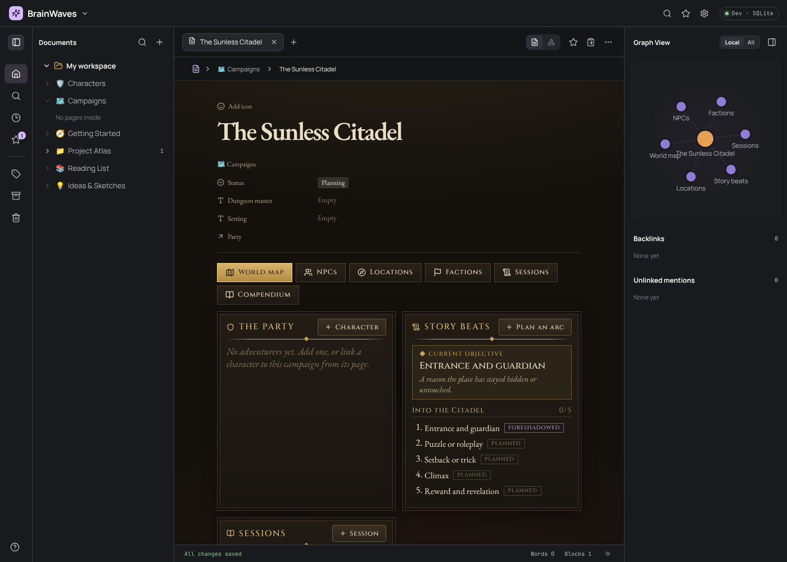
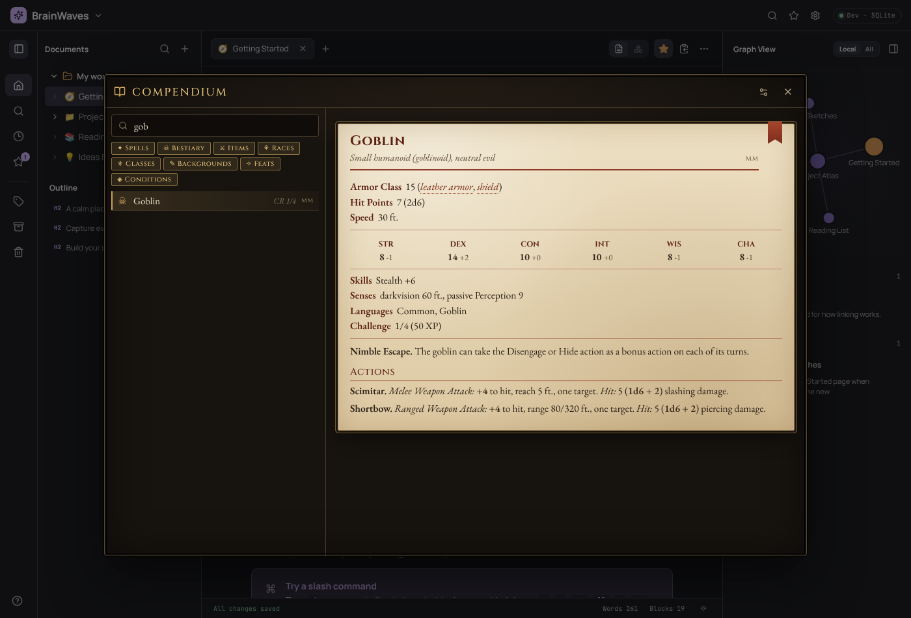
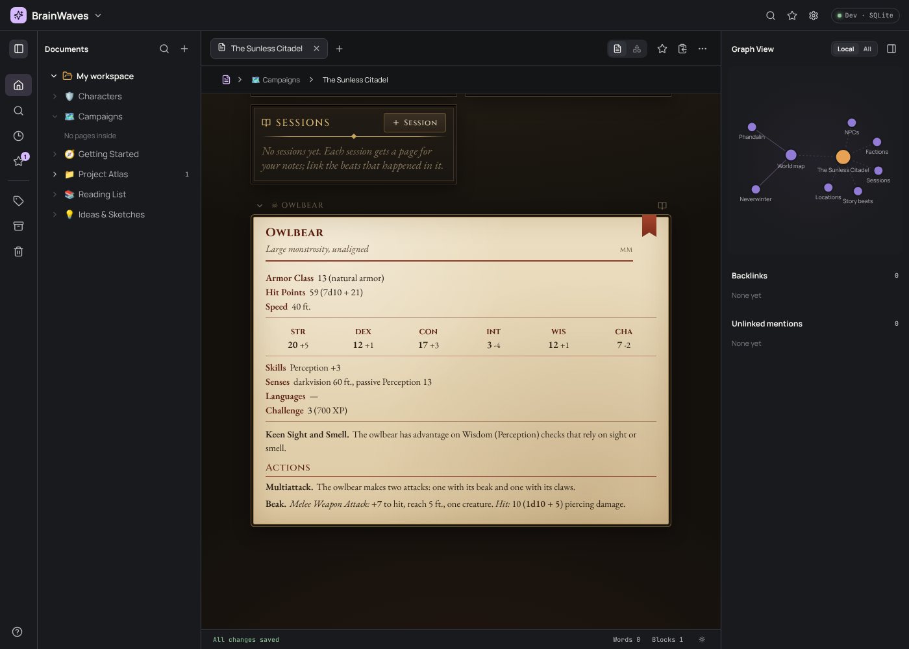
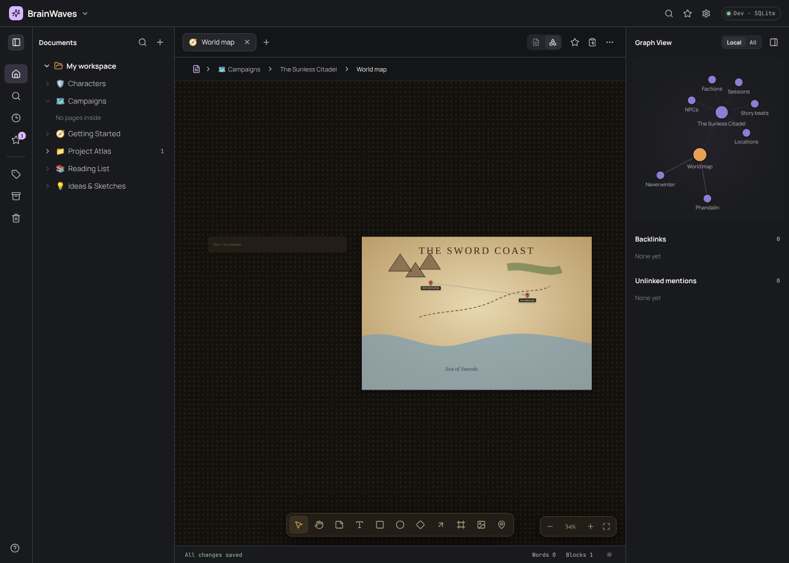
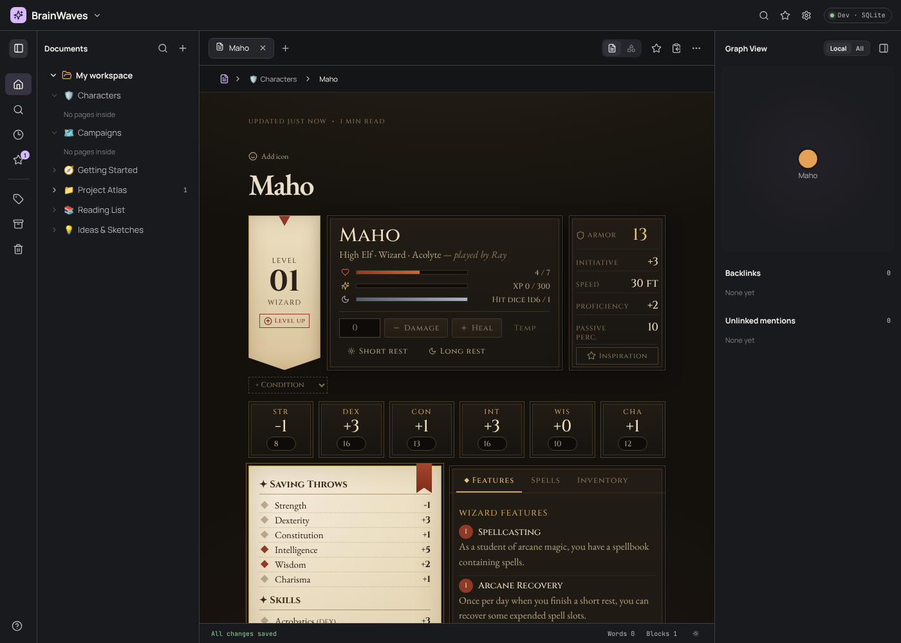

# Dungeons & Dragons in BrainWaves

A campaign manager for the dungeon master, character sheets for the players, and a 5e compendium.
The content comes from your own self-hosted **5etools**. Campaign pages and character sheets get
a dark fantasy look of their own; the rest of BrainWaves keeps its normal style.

---

## 1. Connect your 5etools (once)

BrainWaves reads 5e content (spells, monsters, items, races, classes, backgrounds, feats,
conditions) from your running 5etools site.

1. Start your 5etools as usual, for example at `http://localhost:5050/`.
2. Press **Ctrl Shift D** to open the compendium, then the **⚙** in its corner.
3. Enter the address and press **Save & test**. You should see "Connected: N spells found".

**What is stored and what isn't**
- **Nothing from 5etools is copied into your notes.** Pages keep only references such as
  "Fireball, PHB", and the text is read from your 5etools when you look at it.
- **If 5etools isn't running**, cards say they can't reach it. Your campaign and characters
  themselves don't depend on it.

**How it's fetched.** The desktop app fetches the files itself, so the browser's cross-site
rules (CORS) don't get in the way. It only fetches files under `data/` from that one address.

---

## 2. The compendium

- **Search** across everything at once, or narrow it with the category chips.
- **Read** an entry: monsters get a full stat block; spells, items, races, classes (with their
  features by level) and the rest get their own card.
- **Follow links:** a link in the text (a spell, an item, a condition) opens that entry, and
  **←** takes you back.
- **Put an entry in a page** as a parchment card:
  - `/spell`, `/monster` or `/item` choose from just that category;
  - `/compendium entry` chooses from everything.
- **Cards can be folded** with the arrow above them, and **📖** opens the card's entry in the
  compendium.

---

## 3. For the dungeon master: campaigns

Type **`/campaign`** in any page (or press **New campaign** on the Campaigns database) and give it
a name. The campaign gets its own page, with these sub-pages all linked to each other:

| Part | What it holds |
|---|---|
| **NPCs** | Role, attitude, alive/dead/missing. Linked to their location and faction. |
| **Locations** | Region, city, village, dungeon, wilderness, landmark. Lists the NPCs found there. |
| **Factions** | Their goal and members. |
| **Sessions** | Number, date, summary. Each session has a page for your notes. |
| **Story beats** | The plot (see below). |
| **World map** | A canvas for your map. |

Every NPC, location, faction, session and beat is a page. Write on it freely, and link it with
`[[` like anything else in BrainWaves.

The **campaign page** shows the overview:
- **The party:** each character's race, class, HP and AC.
- **Story beats:** grouped by arc, with the **current objective** (the next planned or
  foreshadowed beat).
- **Recent sessions.**
- **Buttons** to every part of the campaign, and to the compendium.

### Story beats

Beats are **persistent**: they stay in the campaign until you mark them, so nothing you set up
gets lost between sessions. Each beat:
- has a **status**: *planned*, *foreshadowed*, *happened* or *skipped*;
- belongs to an **arc**;
- links the **NPCs, locations and factions** involved;
- links the **session** it happened in, so you can see what happened when.

**To plan an arc from a template**, press **Plan an arc** on the campaign page, choose a
template and name the arc. Its beats are added as *planned*, in order, each with a prompt:

| Template | Beats |
|---|---|
| **Three acts** | Hook, point of no return, rising trouble, midpoint twist, darkest hour, climax, resolution |
| **Hero's journey** | Ordinary world, call to adventure, mentor, threshold, tests, ordeal, reward, road back, return |
| **Five-room dungeon** | Guardian, puzzle, setback, climax, reward and revelation |
| **Mystery** | Crime, first clues, suspects, red herring, real lead, confrontation, aftermath |
| **Heist** | The job, casing, plan, complication, score, double-cross, getaway |

**To move a beat along**, click its status: planned → foreshadowed → happened → skipped.

**The Story beats database** is still there for everything else: a **Board** grouped by status,
and a table sorted by arc and order.

### World maps

Open **World map** from the campaign page (it opens as a canvas). Then:

| To | Do |
|---|---|
| Add the map | Press **I** (or the picture button) and click where it goes, then choose the image. A very large scan is shrunk to at most 4096 px. |
| Mark a place | Press **P** (or the pin button), click a spot, then choose the page it marks. Type to search, or create a new page there. |
| Open a pinned page | Double-click the pin, or select it and press **Open page**. |
| Draw a route | Press **C** and drag from one pin to another. |
| Group a region | Draw a **frame** (**F**) around it, then present your frames like slides. |

**Pins always show the page's current title.** A pinned page lists the map in its **backlinks**,
and the map shows up in the **graph view** too.

---

## 4. For players: characters

Type **`/character`** in any page (or press **New character** on the Characters database, or
**+ Character** on a campaign page). The wizard asks for:

1. **Name** and **player**.
2. **Race**, **class** and **background**, from your 5etools.
3. **Ability scores:** standard array, point buy (27 points) or rolled/manual. Racial bonuses are
   added and shown.
4. **Class skills.** Skills from your background are already ticked.

The character gets a page with the **sheet** at the top, and room for backstory and notes below
it.

- **Status:** HP, XP and hit-dice bars.
  - Type an amount, then **Damage**, **Heal** or **Temp** (temporary hit points absorb damage
    first).
  - **Short rest** brings warlock pact slots back.
  - **Long rest** restores HP and slots, and half your hit dice.
  - At 0 HP, **death saves** appear.
- **Combat numbers:**
  - **Armor class** can be edited.
  - **Initiative**, **proficiency** and **passive Perception** are worked out for you.
- **Inspiration and conditions:** a toggle and chips. Each condition links to its rules.
- **Abilities:** change a score and everything that depends on it updates.
- **Saving throws and skills:** click the ◆ to make a skill proficient, again for expertise, a
  third time to clear it.
- **Features:** your class features up to your level, plus your race's traits and your
  background's feature, read from 5etools.
- **Spells:**
  - Spellcasting ability, save DC and attack bonus.
  - **Spell slots** for full, half, third and pact casters. Click a slot to spend it.
  - Your spells by level, with a *prepared* toggle. **Add spell** opens the compendium.
- **Inventory:** items from the compendium or typed in, quantities, *equipped*, and coins.
- **Level up:** adds the average hit points for your hit die plus your Constitution modifier.
  Spell slots, proficiency bonus and features follow from the new level.

The **Characters** database shows every character's race, class, level, HP and AC. Its **Party**
view is a gallery. A character's **Campaign** puts it in that campaign's party.

---

## 5. How it's built

BrainWaves' module system (phase 6) runs the D&D module as a first-party module,
`brainwaves.dnd`.

**Core (`crates/bw-core/src/dnd.rs`)**
- **The databases** (Campaigns, Characters, and each campaign's parts) are created through the
  module's owned-database capability. Story-beat templates live here too.
- **A character sheet** is one JSON prop on the character's page, `dnd.sheet`. Its headline
  values (race, class, level, HP, AC) are copied into the Characters columns, so tables and the
  party panel can show them.
- **The 5etools address** is checked before it's saved: it must be http(s).

**Canvas (`crates/bw-core/src/surface.rs`)**
- **`image` elements** keep their picture in the page. The search index records only that there
  is one.
- **`pin` elements** refer to a page, which is how backlinks and the graph find them.

**Hosts (`crates/bw-api/src/fivee.rs`)**
- 5etools files are fetched and cached in memory without holding the core's lock, so a large
  bestiary doesn't pause the app.
- Only `data/*.json` paths are allowed.
- The desktop app's commands now run off the main thread.

**App (`apps/desktop/src/dnd/`)**

| File | What it does |
|---|---|
| `fivee.ts` | Loads content (including `_copy` entries and subraces) and searches it |
| `render.tsx` | Renders 5etools' entry format and `{@tags}` |
| `Statblock.tsx` | The parchment cards |
| `Compendium.tsx` | The compendium window |
| `rules.ts` | 5e rules: proficiency, saves, skills, spell slot tables, level-up |
| `CharacterSheet.tsx`, `CharacterWizard.tsx` | The sheet and the creation wizard |
| `Campaign.tsx` | The campaign overview |
| `theme.css` | The look: Cinzel and EB Garamond fonts (installed with the app), parchment, gold trim |

**The theme:**
- **Where it applies:** to a campaign page, everything under it (NPC pages, session notes, the
  world map) and every character.
- **How:** it re-skins the app's own colors, so tables, notes and the canvas all follow.

### Tests

**Rust (`crates/bw-core/tests/dnd.rs`)**

| Test | What it proves |
|---|---|
| A campaign gets its linked databases and a map | The databases live under the campaign, aren't created twice, and beats link to NPCs on both sides. |
| Templates add a planned arc | An unknown template is refused. |
| Characters keep a sheet and join a party | Headline values are copied into the columns and follow damage. Only character pages take a sheet. Theming finds campaigns and characters. There is one Campaigns/Characters pair per workspace. |
| The 5etools address is checked | `file:` and `javascript:` addresses are refused. |
| Map pins and images | Pins make backlinks and are searchable. The picture stays out of the index. Bad images and pins without a page are refused. |

**Browser (scripted, against a small 5etools-format site I built from the free SRD content)**
- **Compendium:** search, a stat block, following a link.
- **Campaign:** a five-room arc, the current objective, cycling a beat's status.
- **Character:** wizard choices High Elf, Wizard, Acolyte, standard array and two skills. The
  results checked against the rules:

  | Value | Result |
  |---|---|
  | INT / DEX | 16 / 16 |
  | HP | 7 |
  | INT / WIS saves | +5 / +2 |
  | Spell save DC | 13 |
  | Level-1 slots | 2 |

- **Damage and level-up:** 3 damage leaves 4/7; levelling up gives 9/12, 3 slots, and *Arcane
  Tradition* appears.
- **World map:** picture, two pins (an existing page and a new one), a route between them,
  backlinks, opening a pin.
- **A monster card** in a campaign page; adding a spell from the compendium.
- **Persistence:** everything is still there after a reload.
- **No console errors.**

### Limits and next steps

- **Subclasses** aren't chosen in the wizard yet. Type one into the sheet; its features aren't
  listed.
- **Racial "choose" bonuses** (e.g. a half-elf's two +1s) and **2024 background bonuses** are
  left to the player: set the scores by hand.
- **5etools `_mod` edits** (used by some variant monsters and items) aren't applied. The copy's
  own fields win.
- **Multiclassing** isn't modelled.
- **Encounters and initiative tracking** for the table aren't here yet. They would fit naturally
  next to sessions.
