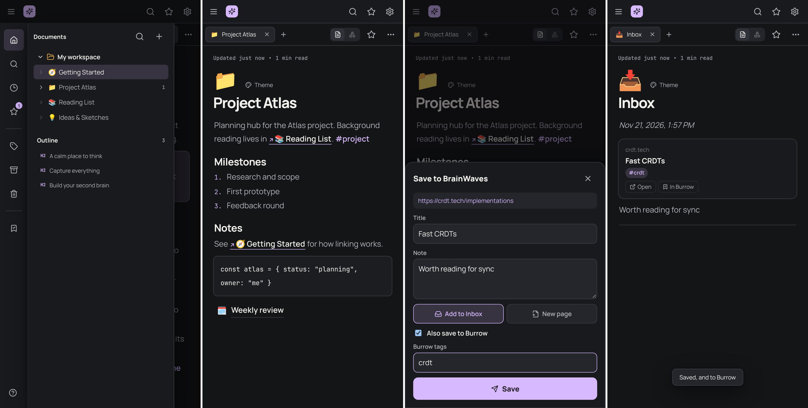

# BrainWaves on Android

Your hosted BrainWaves (see [hosting](hosting.md)) installs as an app on Android, like Burrow:
an icon on the home screen, its own full-screen window, and a place in the **share menu** of
Chrome, YouTube, Reddit and other apps. It works on the notes on your server, so the phone,
the browser and the desktop see the same pages.

## Install it

1. On your phone, open your BrainWaves address (e.g. `https://notes.example.com`) in **Chrome**
   and sign in. It must be **https** (Cosmos or another reverse proxy provides it).
2. Tap **⋮ → Install app** (on some phones **Add to Home screen → Install**). BrainWaves'
   own menu (tap the logo) also shows **Install app** when Chrome offers it.
3. Long-press the icon for two shortcuts: **New page** and **Inbox**.

Updates come by themselves: the app loads the newest version from your server.

## Share into BrainWaves

In any app, tap **Share → BrainWaves**. A sheet opens with the link and the text:

- **Add to Inbox** puts it at the top of your **Inbox** page (made the first time), with the
  date: a running list of things to look at later. **New page** makes its own page under Inbox.
- **Also save to Burrow** (when Burrow is connected, see [Burrow](burrow.md)) saves the link to
  Burrow too, with tags, and puts a Burrow card in the Inbox instead of a plain link.
- Shared text without a link becomes a note.

**Offline?** The app still opens. A share is kept on the phone ("Keep it for later") and goes
into your Inbox the next time you open BrainWaves with a connection.

The share menu works on Android with Chrome, Edge or Samsung Internet. iPhones can add the app
to the home screen (Safari → Share → Add to Home Screen), but iOS doesn't let web apps appear in
the share menu.

## On a phone

- **☰** (top left) opens the menu: the navigation and your pages slide over the page; it closes
  when you open one. Tap outside to close it.
- Tabs scroll sideways; the graph and backlinks panel is left out on small screens.
- Everything else works as on the desktop, including canvases (pinch to zoom) and the Burrow
  panel.

## How it's built

- `apps/desktop/public/manifest.webmanifest`: the app's name, icons (`public/icons/`, including
  a maskable one for Android's shapes), `display: standalone`, the shortcuts, and
  `share_target` (`GET /share?title=&text=&url=`).
- `apps/desktop/public/sw.js`: the service worker. It caches the app itself (HTML, scripts,
  styles, fonts, icons) so it opens offline, and **never** the API (`/api/…`): your notes always
  come from the server. It's registered only on a hosted BrainWaves.
- `apps/desktop/src/mobile/`: the share sheet and offline queue (`share.tsx`), the install
  prompt (`pwa.ts`) and the phone-width switch (`narrow.ts`); the phone layout is the
  `max-width: 760px` block in `styles.css`.
- Tested on an emulated Pixel 7: the layout and drawer, the manifest and service worker,
  Chrome's installability check (no errors), sharing a link into the Inbox and to Burrow, an
  offline share added once back online, and the New page shortcut.
