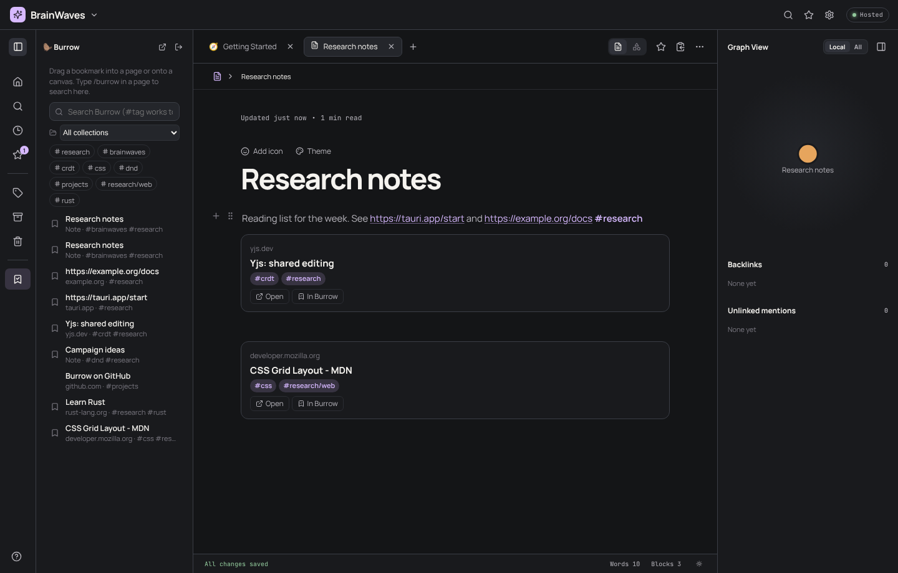
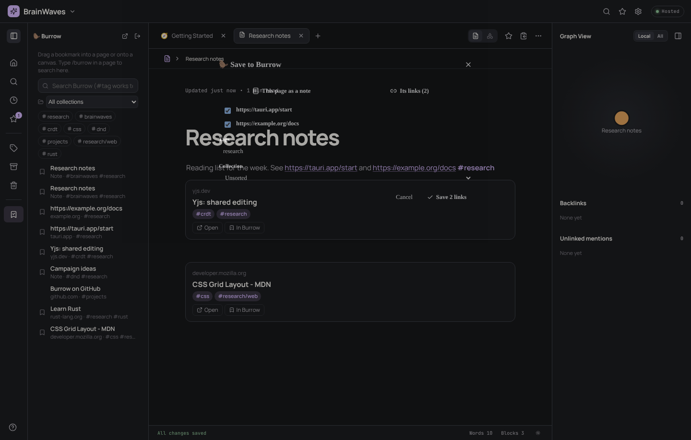
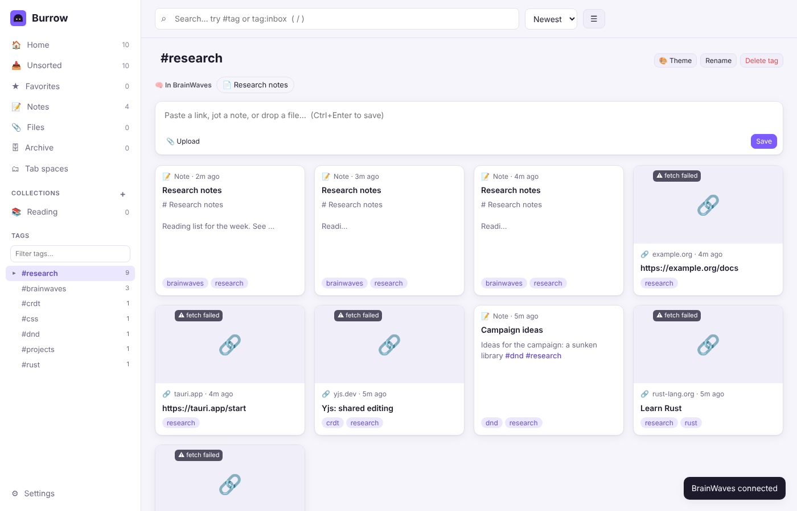

# Burrow and BrainWaves

[Burrow](https://github.com/RayDevXyz/burrow) is your self-hosted bookmark manager, read-it-later
app and web archive. BrainWaves works with it both ways.

| In BrainWaves | In Burrow |
|---|---|
| The **🦫 Burrow** panel: browse and search bookmarks, filter by tag or collection | Tag pages list your **BrainWaves pages** with that tag |
| Drag a bookmark into a page (a card) or onto a canvas (a link card) | `#/b/<id>` links open a bookmark |
| `/burrow` inserts a bookmark card | |
| **Save to Burrow**: a page as a note, or the links in it as bookmarks | |
| A `#tag` page also lists the Burrow bookmarks with that tag | |

## Connect Burrow to BrainWaves

1. In Burrow: **Settings → New token**, and copy it.
2. In BrainWaves: the **Burrow** button in the left rail (🔖), then paste Burrow's address
   (e.g. `https://burrow.example.com`) and the token, and **Connect**.

BrainWaves keeps the token in your workspace and calls Burrow from its own server (or the desktop
app's), so the token never reaches the browser and Burrow needs no CORS settings. BrainWaves only
**reads** bookmarks, tags and collections and **adds** bookmarks; it never changes or deletes
anything in Burrow.

If both run in Cosmos, BrainWaves can reach Burrow by its container address
(`http://burrow:3000`) when they share a network, or by its public address.

### Using it

- **The panel**: search (`#tag` works), pick a tag or a collection, click to open a link. Hover a
  row for **See it in Burrow** and the **archived copy**. Drag a row into a page or onto a canvas.
- **Cards in pages** (`/burrow`, or drag): the bookmark as Burrow has it now: title, picture,
  description, tags (`✦` marks Burrow's AI tags), with **Open**, **In Burrow** and **Archived
  copy**. A card remembers the title and link, so it still makes sense if Burrow is offline.
- **On a canvas**: a link card with the title, site and picture. Double-click opens the link.
- **Save to Burrow** (a page's ⋯ menu, or `/save to burrow`):
  - *This page as a note*: the page in Markdown, titled like the page, tagged with your choice
    of tags plus `#brainwaves`. Saving a page again adds another note.
  - *Its links*: the web links in the page, as bookmarks (Burrow fetches and archives them);
    links Burrow already has get the tags added.
  - Tags start as the page's own `#tags`; pick a collection if you like.
- **Tags**: the BrainWaves **Tags** view lists, under a tag's pages, the Burrow bookmarks with the
  same tag (Burrow's nested tags too: `#research` includes `#research/web`).

## Connect BrainWaves to Burrow (the other way)

This part is a change to Burrow itself, in
[`integrations/burrow/`](../../integrations/burrow/) as a patch for the Burrow repository. Apply it
once (see that folder's README), then:

1. In BrainWaves: **Settings → Account and API tokens… → New token** (name it "Burrow").
2. In Burrow: **Settings → 🧠 BrainWaves**, paste BrainWaves' address and the token, **Connect**.

Burrow's tag pages then show **In BrainWaves** with the pages that have the same tag; each opens
the page in BrainWaves (`#/p/<id>`).

## How it's built

- **BrainWaves core** (`crates/bw-core/src/burrow.rs`): the connection, as a grant of the
  built-in `brainwaves.burrow` module (address and token, in the workspace).
- **Host** (`crates/bw-api/src/burrow.rs`): `burrowGet` (only `bookmarks`, `bookmarks/<id>`,
  `bookmarks/lookup`, `tags`, `collections`, with an allow-list of query parameters),
  `burrowSave` (`POST /api/bookmarks`), `burrowTest`. They run outside the core's lock, like the
  5etools fetches. `burrowConnection` returns the address only.
- **Web app** (`apps/desktop/src/burrow/`): the panel and picker (`Burrow.tsx`), the card block
  (`burrow:card`, `BurrowCard.tsx`), Save to Burrow (`Save.tsx`), the tag section (`Tags.tsx`),
  and the `/` commands (`slash.ts`). Dropping into a page goes through the editor's new
  `EditorHost.dropContent` hook; onto a canvas, it's a `bookmark` element (`surface.rs`).
- **Burrow** (the patch): `server/src/brainwaves.js` (the connection per user in a new
  `integrations` table; `GET /api/integrations/brainwaves/tag/:tag` asks BrainWaves for its tags,
  pages and `pagesWithTag` with the token), and in `public/app.js` the Settings section, the tag
  strip and the `#/b/<id>` route.

Tested end to end with a real Burrow server: connecting, browsing, search, tags, `/burrow` cards,
dragging into a page and onto a canvas, saving links and a page, the shared tag views both ways,
and the links between the two apps.
