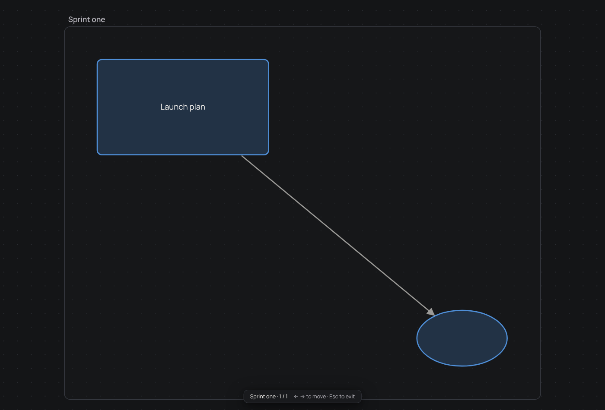
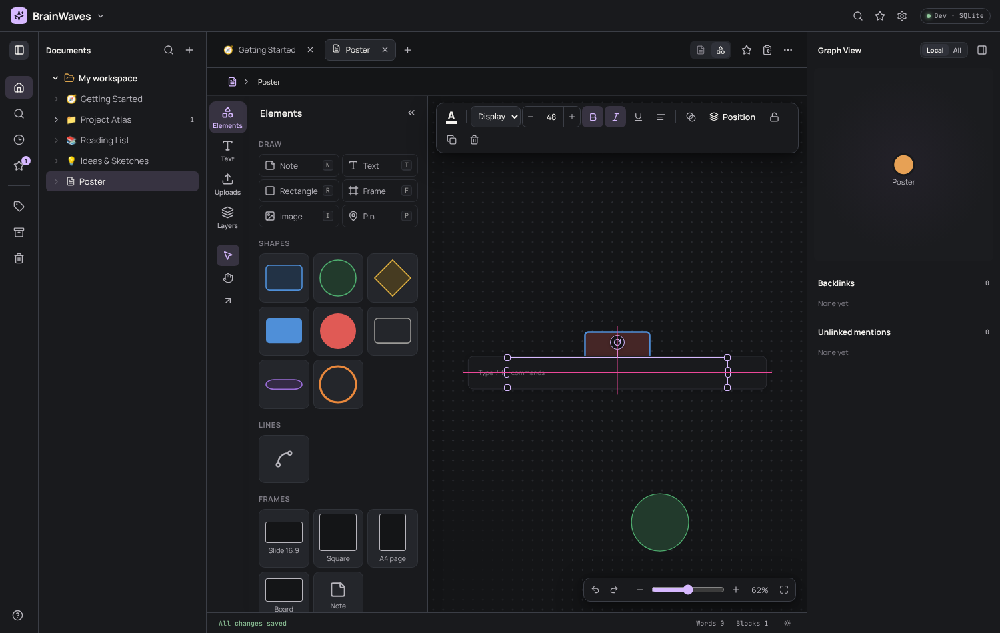
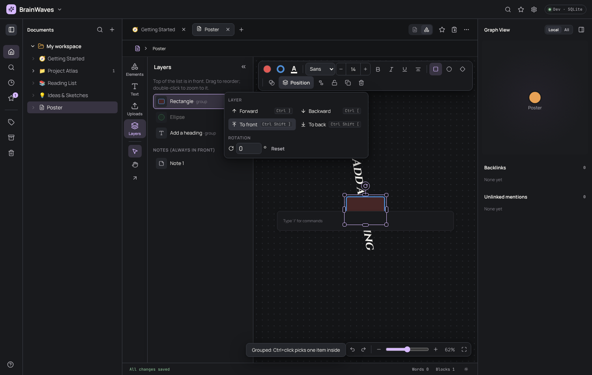
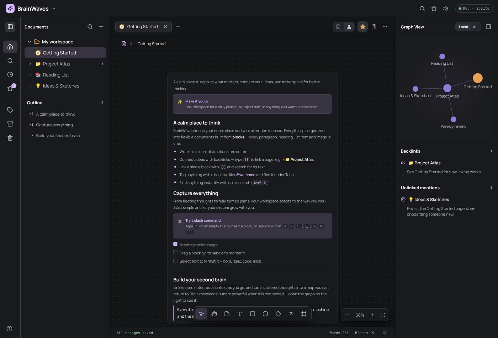

# The canvas

Every page can also be a canvas: a large board where its text sits in notes you can place anywhere, next to shapes, text, pictures, connectors and frames. Switch with **Ctrl Shift E** or the toggle at the top of the page. The page stays one page: its notes are its text in document view too.

## Using the canvas

**Switching views.** Use the two buttons left of the ★ in the tab bar (document / canvas), or
**Ctrl Shift E**. The app remembers which pages you keep as a canvas.

| To | Do |
|---|---|
| Pan | Wheel or trackpad, the hand tool (H), or hold Space and drag |
| Zoom | Ctrl + wheel or pinch, the − / + buttons in the zoom bar (top right), Ctrl 1 to fit |
| Add a note | N, then click or drag. It shows in the document too. |
| Add text | T, or double-click on empty space |
| Add a shape | R (rectangle), O (ellipse) or D (diamond), then click or drag |
| Connect two things | C, then drag from one item to another (or to empty space) |
| Add a frame | F, then drag around things |
| Edit text | Double-click a shape, text box, frame title or connector |
| Move | Drag an item. Drag a note by its top strip, so clicks inside it still edit text. |
| Move a frame | Drag its title. Everything inside moves with it. |
| Resize | Corner handles (shapes, text, frames), or the side handles (notes: width only) |
| Select several | Drag on empty space, or Shift-click |
| Style | The context bar at the top: colors, border, font, size, transparency, position |
| Keep a note out of the document | Select it, then click **In document** to switch it to **Canvas only** |
| Duplicate, delete, nudge | Ctrl D, Del, arrow keys (Shift for 10px) |
| Undo / redo | Ctrl Z / Ctrl Shift Z, or the first two buttons of the tool bar (note text keeps its own undo) |
| Present | ▶ in the zoom bar (shown once a frame exists). ← → move between frames, Esc exits. |

### Design tools

The canvas is laid out like a design editor (LidoJS, Canva).

**The tool bar** floats at the bottom of the canvas: Undo and Redo; Select and Pan; Note, Text, Rectangle,
Ellipse, Diamond, Connector and Frame; Picture and Pin (and Token and Reveal on battle maps). The
last button, **Assets**, shows or hides the canvas's assets in the right panel. The zoom bar (zoom,
fit, present) sits in the top right corner; on battle maps, in the top left, beside the table
panel.

**The assets** are in the right panel while a canvas is open. Its **Assets | Graph** switch goes
back to the usual graph and backlinks, and back again; the panel remembers which you chose.

| Tab | What's there |
|---|---|
| **Elements** | The drawing tools; ready-made shapes (outlined, solid, label, ring); connectors; frames sized as a 16:9 slide, a square, an A4 page or a board; a note. **Click** one to add it in the middle of the view, or **drag** it onto the canvas. |
| **Text** | A heading, a subheading and body text, plus font combinations (Display, an italic serif, handwriting, code). |
| **Uploads** | Upload a picture, add one you uploaded this session again, or jump to a picture on this page. You can also drop picture files straight onto the canvas. |
| **Layers** | Everything on the canvas, front first. Drag to reorder, 👁 to hide (kept, not drawn), 🔒 to lock, click to select, double-click to zoom to it. |

**The context bar** (top) shows what you can do with the selection:

- **Colors:** fill (or none), border color and width for shapes; text color; any color with
  **+** besides the palette.
- **Text** (text boxes and words on shapes): font (Sans, Serif, Display, Mono, Hand), size,
  bold, italic, underline, alignment.
- **Shape kind** (rectangle, ellipse, diamond) and **transparency**.
- **Position:** forward/backward and to front/back; with two or more items, align their
  edges or centers; with three or more, even spacing; the exact rotation.
- **Group** and **ungroup**, **lock**, **duplicate**, **delete**. A pin also gets **Open page**,
  a note **In document / Canvas only**.

**Moving, resizing, turning:**

- **Smart guides:** while you move or resize, pink lines show when an edge or center lines up
  with another item, and it snaps there. Hold **Ctrl** to move freely.
- **Eight handles** on shapes, frames and pictures. Pictures keep their proportions from the
  corners (**Shift** to stretch); for shapes, **Shift** keeps them. A label shows the size.
- **The round handle** above the selection turns shapes, text and pictures. It settles on
  0°, 90°, 180° and 270°; **Shift** turns in 15° steps.
- **Groups:** select a few things and press **Ctrl G**. A click then takes the whole group;
  **Ctrl-click** picks one item inside it. **Ctrl Shift G** ungroups.
- **Locked** items can be selected but not moved, resized or deleted (**Alt Shift L**).

| Keys | |
|---|---|
| Ctrl ] / Ctrl [ | Forward / backward |
| Ctrl Shift ] / Ctrl Shift [ | To front / to back |
| Ctrl G / Ctrl Shift G | Group / ungroup |
| Alt Shift L | Lock or unlock |

**Opening a page on the canvas for the first time.** Notes that were never placed are laid out
in a column, each below the last, and the view zooms to fit. A normal page opens as its document
on a card, as below.

---

## Splitting a page into parts

In canvas view (Ctrl Shift E), a page's text is one note at first. You can cut it into parts and lay them out freely. Each part is still a note of the same page, so in document view the parts read in order, one after the other.

### Split

Click into a note. Its bar at the top has two split buttons:
- **✂ Split at the cursor:** the block the cursor is in, and everything after it, becomes a new part placed to the right.
- **≡ Split at each heading:** a new part starts at each heading of the highest level the note uses. Text before the first heading stays where it is. The parts are laid out in a row.

A new part goes right after its original in the document order. Splitting the first of several notes therefore keeps the text in order.

### Move, select, group

- **Move a part:** drag the strip at its top. It moves on its own.
- **Select several:** drag a box over them on an empty spot, or Shift-click. Then drag one to move them all.
- **Group:** **Ctrl G** groups the selection; notes can be grouped together and with shapes, text and pictures. Clicking any member then selects the whole group, and the group moves together. Ctrl-click picks one member inside the group. **Ctrl Shift G** ungroups.

### Merge

Select two or more notes and click **Merge**. The top-left one keeps its place. The others' content is added after its own, in reading order (top to bottom, then left to right), and they're removed.

### Under the hood

Each part is an entry in the page's `notes` map, with its own `order`, `xywh` and optional `group`; see `apps/desktop/src/edgeless/split.ts`. A note is removed only after its editor has closed: deleting a note while its editor is still bound to it breaks the editor.
