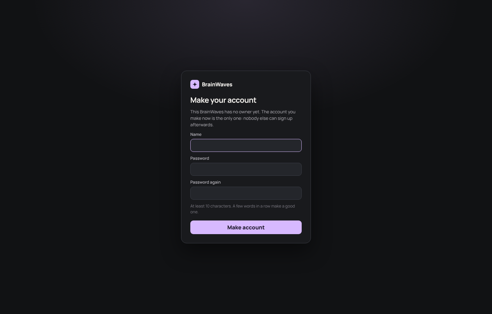

# Hosting BrainWaves on your server

BrainWaves runs as a web app on your own server (a VPS), like Burrow: one Docker image with the
app and its server (`bw-server`), your own login, and your workspace in a Docker volume. You open
it in any browser at your own address, e.g. `https://notes.example.com`. The desktop app keeps
working as before, with its own local workspace.



## On a VPS with Cosmos Cloud

GitHub Actions builds the images on every push to `main` (`.github/workflows/docker.yml`):
`ghcr.io/raydevxyz/nmuch` (BrainWaves) and `ghcr.io/raydevxyz/nmuch-table` (the D&D table).

1. **Make the images public** (once): on GitHub, go to your profile → **Packages** → `nmuch`
   (and `nmuch-table`) → **Package settings** → **Change visibility** → Public. Otherwise the
   server needs a GitHub login to pull them.
2. **Point your domain** at the VPS: a DNS **A record** for `notes.example.com` (and
   `table.example.com` if you use the table).
3. In Cosmos, open **ServApps**, **import a compose file**, and paste
   [`deploy/brainwaves/cosmos-compose.yml`](../deploy/brainwaves/cosmos-compose.yml). Set
   `BW_TABLE_DM_KEY` to a long random key, or delete the `brainwaves-table` service if you don't
   use the D&D table.
4. In Cosmos **URLs**, create:
   - `notes.example.com` with target **`http://brainwaves:8080`**;
   - `table.example.com` with target **`http://brainwaves-table:8090`** (optional).

   Cosmos provides the HTTPS certificates. Turn **off** Cosmos's own "Authentication required"
   for both: BrainWaves has its own login, and players must reach the table without one.
5. Open `https://notes.example.com` **right away** and make your account. The first account
   becomes the owner and nobody else can sign up afterwards, so don't leave a fresh install
   waiting.

To update, push to `main`, wait for the GitHub Action, then update or recreate the containers in
Cosmos so they pull the new `latest` images.

## With Docker Compose (any server)

```sh
git clone https://github.com/RayDevXyz/nmuch && cd nmuch/deploy/brainwaves
docker compose up -d --build
```

It listens on port 8080. Put it behind HTTPS (Caddy, Traefik, nginx) and set `TRUST_PROXY=true`:

```
notes.example.com {
  reverse_proxy localhost:8080
}
```

Without Docker: build the web app (`pnpm install && pnpm --filter @brainwaves/desktop build`) and
the server (`cargo build --release -p bw-server`), then run
`WEB_DIR=apps/desktop/dist DATA_DIR=/srv/brainwaves ./target/release/bw-server`.

| Setting | Default | |
|---|---|---|
| `PORT` | `8080` | The port. |
| `DATA_DIR` | `./data` (Docker: `/data`) | The workspace (`brainwaves.db`) and the login (`auth.json`). |
| `WEB_DIR` | `./web` (Docker: `/app/web`) | The built web app. |
| `TRUST_PROXY` | `false` | `true` behind an HTTPS reverse proxy: secure cookies, and the client's address from `X-Forwarded-For` (for the sign-in limits). |

## On your phone

Open it in Chrome on Android and **Install app**: an app icon, and BrainWaves in the share menu.
See [android.md](android.md).

## Your account

- **Settings → Account and API tokens…**: sign out, change the password (other browsers are
  signed out), and make **API tokens** for other apps (Burrow, scripts). A token is shown once;
  it can use BrainWaves' API (`Authorization: Bearer …`, `POST /api/<command>`) but not the
  account itself.
- After 5 wrong passwords from one address, sign-in waits 15 minutes.
- Forgot the password? On the server, stop the container and delete `auth.json` from the data
  volume; the next visit makes the account again. Your pages are untouched.

## Backups

Everything is in the data volume: `brainwaves.db` (every page and its history) and `auth.json`.
Back up the volume, or copy `brainwaves.db` while the container is stopped (or use
`sqlite3 brainwaves.db ".backup backup.db"` while it runs).

## How it's built

- `crates/bw-server`: axum. `POST /api/<command>` runs the same `bw_api::dispatch` as the desktop
  app; `GET /api/events` streams changes (Server-Sent Events); `/api/auth/*` is the account;
  everything else serves the web app (`index.html` for app routes).
- **Login** (`auth.rs`): one owner. Passwords are hashed with Argon2id; sessions (30 days) and
  API tokens are random and stored only as SHA-256 hashes. The session cookie is `HttpOnly`,
  `SameSite=Lax`, and `Secure` behind a proxy. Every API call needs the session or a token.
- **The web app** asks `/api/auth/state` first and shows the sign-in when needed
  (`apps/desktop/src/auth/`). With the desktop app or the dev server there's no sign-in.
- **What differs from the desktop app:** the server never opens files in desktop apps, and the
  folder features (courses from a folder) read folders on the server.
- `#/p/<page id>` opens a page (links from Burrow and other apps).
- Tests: `cargo test -p bw-server` (the account, sessions, wrong passwords, tokens, the protected
  API over real HTTP).
