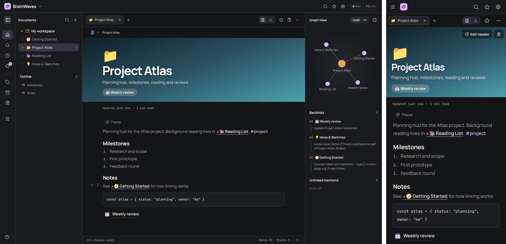
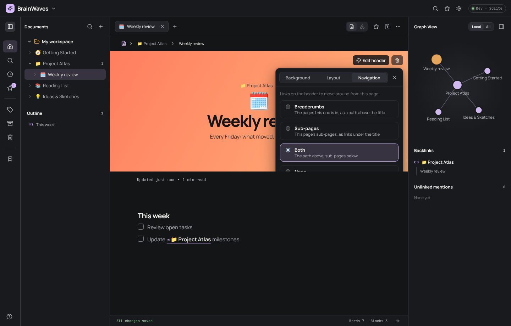
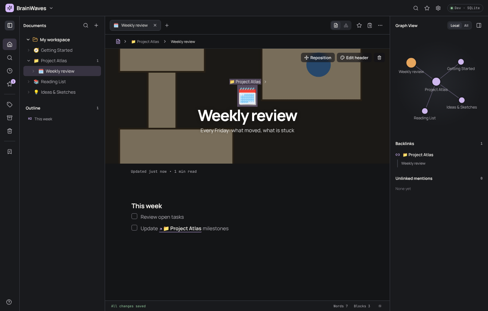

# Page headers

Any page can have a **header**: a gradient, a color or a picture across the top, with the page's
icon, title and a subtitle on it, and links to move around: where the page is (breadcrumbs) and
its sub-pages.

## Add one

Hover a page's title area and click **Add header** (next to *Add icon* and *Theme*). It starts
as a gradient with the title at the bottom left and the breadcrumbs above it. Hover the header
for its buttons:

- **Edit header**: the settings below. Changes show at once.
- **Reposition** (pictures): drag the picture up or down, then **Done**.
- 🗑 removes the header; the title goes back to the page.

The title stays editable inside the header, like anywhere else.

## Settings

**Background**
- **Gradient**: twelve ready-made ones (Aurora, Sunset, Ocean, Forest, …), or your own two or
  three colors and the angle.
- **Color**: one color.
- **Picture**: upload one (scaled to at most 2400 px wide and stored in the page), or paste the
  address of one on the web. **Blur** softens it.
- **Darken** puts a shade over any background, so the title reads well on busy pictures.

**Layout**
- **Height**: Small, Medium, Large or Tall, or any height from 100 to 640 px.
- **Title**: left, centered or right; at the top, middle or bottom; its size (60–180%).
- **Text**: light or dark, or *Automatic* (picked from the background's brightness).
- Show or hide the page's **icon**, and add a **subtitle**.

**Navigation**
- **Breadcrumbs**: the pages this one is in, as a path above the title.
- **Sub-pages**: the page's sub-pages, as links under the title (up to 12).
- **Both**, or **None**.

## How it's built

- The header is part of the page: a `header` map in the page's Y.Doc, one plain value per
  setting (see `crates/bw-core/src/schema.rs`). It syncs, undoes and backs up with the page; the
  core keeps it but doesn't read it.
- `apps/desktop/src/header/model.ts` checks every value when reading (colors are `#hex`,
  pictures are `data:image/…` or `http(s)` addresses, numbers are clamped) and builds the CSS
  from them, so no stored text ever becomes CSS directly.
- `apps/desktop/src/header/PageHeader.tsx` draws it and its settings panel; `Editor.tsx` puts
  the icon and title in it when a page has one.
