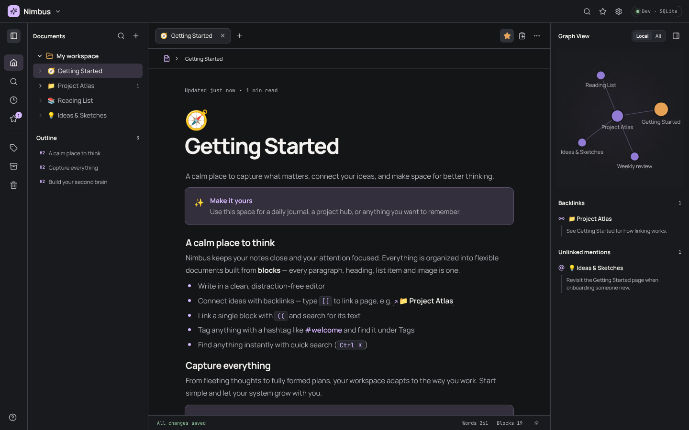
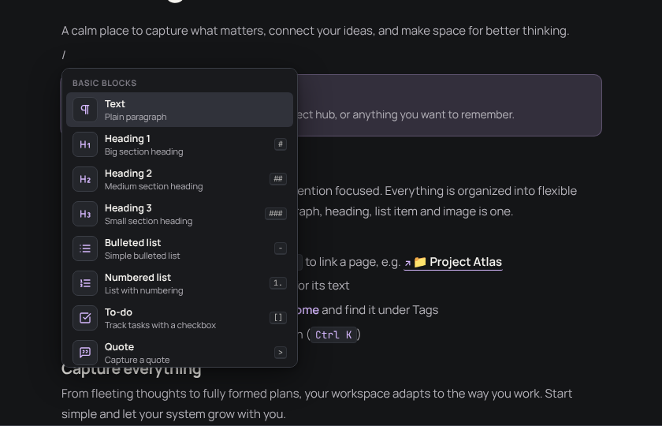
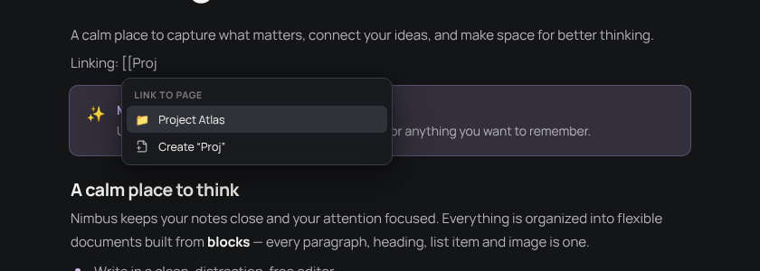
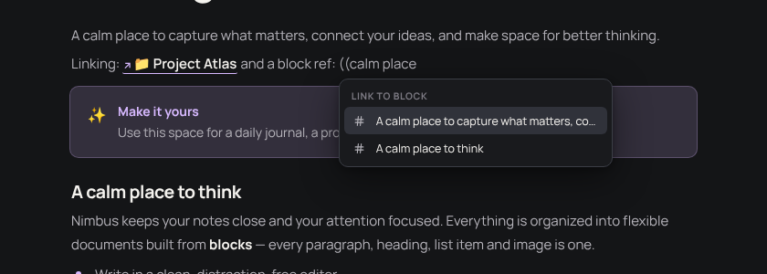
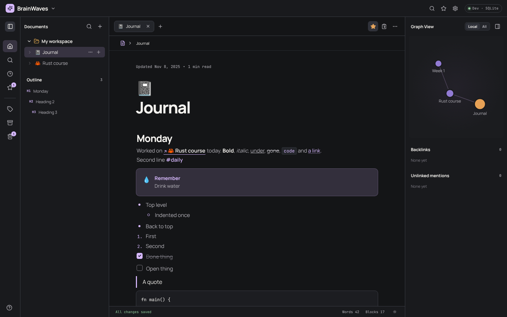

# Phase 2: Doc-mode editor (Tiptap) on the Rust core, inside Nimbus

> **Follow-up:** the app has since been renamed **BrainWaves**, and it can import notes from
> the old Nimbus app. See [section 12](#12-follow-up-renamed-to-brainwaves--nimbus-import).
> "Nimbus" below refers to the shell as it arrived.

**Status:** working end to end, in the browser and in Tauri.
- **Rust tests:** 21 pass.
- **JS contract tests:** 3 pass.
- **Typecheck and clippy:** clean.
- **Manual run:** a scripted browser session found no console errors.

**Branch:** `claude/dazzling-einstein-0r1sxx`.
**Builds on:** [Spike 1](spike-01-block-model.md) (update log + index).
**Plan:** step 2 of the build order in `BrainWaves Core Architecture.md`.



*Everything in this screenshot comes from the new stack:*
- *The page is a Y.Doc loaded from the Rust update log.*
- *The text is a Tiptap editor.*
- *The sidebar tree, outline, graph, backlinks, "unlinked mentions" and tag colouring come from the Rust SQL index.*

---

## 1. The decisions this phase is built on

Three choices were made in conversation before any code was written:

1. **Build our own editor on Tiptap, not BlockSuite.** BlockSuite's flexibility lives inside
   *its* framework (Lit, its store, its Y.Doc layout). BrainWaves needs the Rust core to own
   the data format, because modules, the index and publishing all read it.
2. **One editor per *note*, not one per block** (option A). A page holds one or more notes.
   Each note is one Tiptap editor, so selecting across blocks, copy/paste, undo and drag and
   drop all work natively. In doc mode, notes are stacked, and most pages have exactly one.
   In edgeless mode (later), each note becomes a card on the canvas.
3. **Use Nimbus as the app shell.** You shared Nimbus mid-way. Its shell (sidebar, tabs,
   quick find, graph, backlinks, themes) was already good. Only its storage layer and its
   per-block editor got replaced, and everything else was kept.

---

## 2. The big picture

```text
┌──────────────────────────── apps/desktop (Nimbus shell, React) ────────────────────────────┐
│ Sidebar · Tabs · QuickFind · RightPanel (graph, backlinks) · TopBar · StatusBar            │
│                                                                                            │
│ editor/Editor.tsx  ──  page chrome (icon, title) + one <NoteEditor> per note               │
│        │                                                                                   │
│        │  EditorHost (search pages, create page, live titles, open, emoji, images, md)     │
│        ▼                                                                                   │
│ ┌────────── packages/editor (@brainwaves/editor) ───────────┐                              │
│ │ Tiptap schema · block ids · ref/callout/image/pageLink    │                              │
│ │ slash, [[ and (( menus · toolbar · drag handle · md I/O   │                              │
│ └───────────────────────────────────────────────────────────┘                              │
│        │ y-tiptap binds each editor to one Y.XmlFragment                                   │
│        ▼                                                                                   │
│ lib/core/page-sync.ts: one Y.Doc per open page  ◄── pull on event ──┐                      │
│        │ push merged updates                                        │                      │
│ lib/storage: page metadata + index queries                          │                      │
│        ▼                                                            │                      │
│ lib/core/client.ts:  call(command, args)          onEvent(cb)  ─────┘                      │
└────────┬───────────────────────────────────────────────▲───────────────────────────────────┘
         │ Tauri: invoke('core_call')                    │ Tauri: 'core-event'
         │ Browser: POST /api/<command>                  │ Browser: SSE /api/events
         ▼                                               │
   crates/bw-api ── dispatch(command, args) ─────────────┤      (crates/bw-devserver serves
         ▼                                               │       bw-api over HTTP for the browser)
   crates/bw-core ── Core: the single writer ────────────┘
         │  1. apply to Y.Doc   2. append update to log   3. re-project index   4. emit event
         ▼
   SQLite:  pages, updates (truth)  │  page_meta, blocks, props, refs, tags, index_state (index)
```

Nothing in the frontend writes to disk. The editor changes its own Y.Doc. The page sync sends
the Yjs update to the core, and the core logs it, indexes it and broadcasts an event. This is the
transaction path from Spike 1, now carrying a real editor.

---

## 3. The page layout (schema 2)

File: `crates/bw-core/src/schema.rs`. Its mirror is `packages/editor/src/schema.ts`.

```text
Y.Doc (one per page)
├── "page":    Y.Map   { id, schema: 2, title, icon, parent, key, favorite, archived, trashedAt }
├── "notes":   Y.Map<note_id, Y.Map {
│                  id:      String
│                  order:   String          fractional key: doc mode shows notes in this order
│                  xywh:    [x,y,w,h] | null  position on the edgeless canvas (later)
│                  content: Y.XmlFragment   ← the ProseMirror document of this note
│              }>
├── "props":   Y.Map<block_id, Y.Map<key, Any>>   module data: "course.progress", …
└── "surface": Y.Map   reserved for edgeless shapes, arrows and frames
```

### 3.1 What changed from Spike 1, and why

| Spike 1 | Phase 2 | Why |
|---|---|---|
| Flat `blocks` map. Each block had a `Y.Text` and a `children` array | Each note is a `Y.XmlFragment`: a tree of elements | Tiptap syncs through y-prosemirror (Tiptap's fork is `@tiptap/y-tiptap`), which stores a document as an XML fragment. Matching it means the editor and the core read the **same** structure, with no translation layer. |
| Page title was the root block's text | Page metadata lives in the `page` map | Nimbus needs title, icon, tree position, favorite, archived and trash. These are last-writer-wins fields, so a map is right. |
| Block props on the block | `props` map keyed by block id, outside the XML | Module data (`course.*`) shouldn't be inside the editor's schema. Keeping it outside means the editor never has to know about modules, and props survive the block being edited or moved. |
| (none) | `notes` + `surface` | Prepares edgeless mode: notes get `xywh`, and shapes go in `surface`. |

### 3.2 How a ProseMirror document looks inside the XML fragment

Suppose a note contains:

> **Week 1** (heading)
> See [[Reading list]] #rust
> ☑ Lesson 1

y-tiptap stores it like this. You can see this exact structure with
`cargo run -p bw-core --example contract_fixture`.

```xml
<heading id="72df…" level="1">Week 1</heading>
<paragraph id="f814…">See <ref kind="page" target="9d6c…"></ref> #rust</paragraph>
<taskList id="a1b2…">
  <taskItem id="c3d4…" checked="true">
    <paragraph id="e5f6…">Lesson 1</paragraph>
  </taskItem>
</taskList>
```

The rules:
- **Element tag = ProseMirror node name.** Attributes are the node's attrs, with their real types
  (`level` is a number and `checked` a boolean, not strings).
- **Text** is a `Y.XmlText` child. Marks (bold, italic, link, …) are formatting attributes on it.
- **Every block node has an `id` attribute.** That id is the block's identity everywhere: the
  index, `((block refs))`, `props`, "reveal this block" from search.
- **Inline nodes** (`ref`, `hardBreak`) are elements *without* an id.

---

## 4. The editor package (`packages/editor`)

This is the "block engine behind an interface" from the architecture doc. It knows the schema,
the renderers and the commands. It knows nothing about storage or about Nimbus.

| File | What it does |
|---|---|
| `schema.ts` | The list of block and inline node names (the contract with Rust). |
| `kit.ts` | `schemaExtensions()` defines the schema: StarterKit (paragraph, headings, lists, quote, code, rule, marks, link), task lists, callout, image, page link, ref and block ids. `editorExtensions()` adds the live-editor parts: collaboration binding, menus, placeholders, tag highlighting and Markdown paste. Headless code (tests, seeding, conversions) uses the first list, so it can never disagree with the editor about the schema. |
| `block-id.ts` | Gives every block a unique `id`. New blocks get one in the same transaction they appear in. On a split, the first half keeps the id. Pasted content gets fresh ids, so a block copied from another page doesn't steal its id. |
| `nodes/ref.tsx` | **The inline reference**: an inline atom node `{ kind: "page" \| "block", target }`. It stores *only the target id*. The label is the target's **current** title, looked up through the host, so renames show up everywhere instantly. This is the "inline embed" option from our earlier discussion. |
| `nodes/callout.tsx` | A text block with an emoji. Markdown shortcut `!> `. |
| `nodes/page-link.tsx` | A sub-page shown as a block (Nimbus's "Sub-page"). |
| `nodes/image.tsx` | A block image with an editable caption. Pasting or dropping image files works. |
| `nodes/tags.ts` | Highlights `#tags` using the same rule as the Rust tag extractor. |
| `nodes/markdown-paste.ts` | Pasting plain-text Markdown turns it into blocks (through the host). |
| `menus/suggestions.tsx` | `/` slash commands, `[[` page links (with "Create …") and `((` block refs. |
| `menus/FormatToolbar.tsx` | The bold / italic / underline / strike / code / link toolbar over a selection. |
| `menus/BlockHandle.tsx` | The `+` and grip left of the hovered block. Drag the grip to move the block. Click it for *Turn into*, *Duplicate*, *Delete* and (on callouts) *Change icon*. The menu opens upwards when there's no room below. |
| `NoteEditor.tsx` | One Tiptap editor bound to one note's `Y.XmlFragment`. |
| `inspect.ts`, `markdown.ts` | Outline, word counts and Markdown export from ProseMirror JSON. |

### 4.1 `EditorHost`: why the editor asks instead of knowing

```ts
interface EditorHost {
  searchPages(query)            // for [[
  createPage(title, opts?)      // [[ "Create …", /Sub-page
  searchBlocks(query)           // for ((
  useRefTarget(kind, id)        // React hook: live title of a ref target
  openRef(kind, id, newTab)     // click on a ref
  pickEmoji(anchor)             // callout icon
  readImage(file)               // image paste/drop -> src
  openExternal(url)             // Ctrl+click a link
  markdownToContent?(text)      // Markdown paste
}
```

The editor package never imports app state. Nimbus implements the host in
`apps/desktop/src/editor/Editor.tsx`, mostly as thin calls into its store and the core. A
widget or a module page could implement it differently.

---

## 5. Keeping the editor and the core in sync

File: `apps/desktop/src/lib/core/page-sync.ts`.

```text
 open page          editor keystroke                         another window / the core changes the page
     │                    │                                                   │
     ▼                    ▼                                                   ▼
 loadPage ─► whole    Y.Doc 'update' event ─► queue ─(120 ms)─► merge ─►  core emits pageChanged
 page as one update        (origin ≠ core)                     pushUpdate      │
     │                                                             │           ▼
 apply with origin                                   core: apply, log,   pullUpdate(my state vector)
 "core" (not sent back)                              index, emit event   → exactly what I'm missing
                                                                         → apply with origin "core"
```

- **One `PageSync` per open page**, reference-counted. The editor, "Copy as Markdown" and
  "Duplicate page" share it when they look at the same page.
- **Local edits** are queued, merged with `Y.mergeUpdates`, and pushed after 120 ms of quiet.
  Pushes are chained, so they reach the core in order. Each push shows up in Nimbus's
  "Saving… / All changes saved" indicator.
- **Remote changes:** when the core reports `pageChanged` for an open page, the frontend sends
  its *state vector* (a compact "what I already have") and gets back only the missing part.
  Pulls are coalesced, so a burst of events causes at most one pull in flight plus one after.
- **Echo protection:** updates applied from the core use the transaction origin `"core"` and are
  never sent back.
- **Two windows on the same page** stay in sync this way. This was tested: text typed in window
  B appeared in window A without a reload. This is the architecture doc's "live comes for free":
  nothing connects the two windows except the core.

---

## 6. The index (schema 2)

File: `crates/bw-core/src/index.rs`. Queries are in `crates/bw-core/src/query.rs`.

| Table | Contents | Feeds |
|---|---|---|
| `page_meta` | id, parent, title, icon, sort key, favorite, archived, trashed, created/updated | Sidebar tree, favorites, archive, trash, recent |
| `blocks` | every block **plus** a row for the page and one per note; text and attrs (JSON) | Search, mentions, `((` lookup |
| `props` | module properties, as JSON | Module queries (`course.progress < 1`) |
| `refs` | `[[page]]`, `((block))` and sub-page links, in text order | Backlinks, graph |
| `tags` | `#tags`, lower-cased | Tags view |
| `index_state` | the last log entry each page's projection reflects | Self-healing on startup |

Every query Nimbus used to run against its own tables now runs here:
- `list_pages`, `backlinks`, `mentions` (unlinked), `links` (the graph), `tags`,
  `pages_with_tag`, `search` and `block_infos`.
- Trashed pages are excluded wherever Nimbus excluded them.

### 6.1 How refs avoid stale text

A block's indexed text stores **a marker character (U+FFFC)** where each inline ref sits. It
doesn't store the target's title. When a query returns text (backlinks, search, block refs),
it swaps each marker for the target's **current** title. Renaming a page therefore never leaves
stale text in other pages' index rows, and the test `queries_answer_from_the_index` checks this.

### 6.2 `updated_at` comes from the log

A page's `updated_at` is the time of its last log entry, and `created_at` is when it was created.
Neither is stored in the doc, so a keystroke never needs a second "touch the timestamp"
update. Compaction keeps the original time of the last write.

---

## 7. What changed in Nimbus

The first commit on this phase imports Nimbus **unchanged** (`Import Nimbus as apps/desktop`), so
`git diff d9d9723` shows exactly what moved.

| Nimbus file | Now |
|---|---|
| `src-tauri/src/db.rs` (own SQLite schema) | **Removed.** `src-tauri/src/lib.rs` opens `bw-core` (`brainwaves.db` in the app data dir; the old `nimbus.db` is left untouched) and exposes one command, `core_call`, plus the `core-event` stream. |
| `lib/storage/tauri.ts`, `browser.ts` (IndexedDB) | **Removed.** `lib/storage/index.ts` implements the `Storage` interface on top of the core client. The browser now uses the dev server instead of IndexedDB, so it runs the *same* Rust code as the desktop app. |
| `editor/Editor.tsx` (1,693 lines, custom contentEditable per block), `BlockView.tsx`, `InlineToolbar.tsx`, `blockTypes.ts`, `lib/blocks.ts` | **Replaced** by a ~360-line `Editor.tsx`, which keeps the page chrome (meta line, icon, title) and renders `NoteEditor`s, plus `@brainwaves/editor`. |
| `lib/types.ts` → `Storage` | No more `getBlocks` / `saveBlocks` (content goes through Yjs). Adds `createPage`, `updatePage(patch)` and `blockInfos`. |
| `state/actions.ts` | Page writes go to the core. The page list refreshes itself from core events. A small "dirty" set keeps your local title while you type, so a refresh can't revert it. `duplicatePage` copies notes through Yjs. |
| `lib/seed.ts` | Same sample pages, built with the new converter (`lib/convert.ts`: Nimbus-style blocks → HTML → Tiptap JSON). |
| `styles.css` | Added a section that styles Tiptap content (`.bw-prose`) to match the Nimbus look. Nothing else changed. |
| Sidebar, tabs, quick find, graph, backlinks, help, top bar, themes | **Unchanged** apart from the storage label in the top bar. |

### 7.1 Two bugs found while testing in a real browser

1. **Opening a brand-new page raced its creation.** Nimbus opens a new page instantly, so the
   editor asked the core for a page whose "create" write hadn't landed yet and got a 400. Now
   page sync waits for a pending create of that page.
2. **Enter in the title, then fast typing.** Tiptap's `focus()` waits one animation frame, so
   the first letter could still land in the title. The title now moves the caret into the
   editor synchronously.

---

## 8. The contract test: making sure Rust and Tiptap agree

If the Rust core writes a node the editor's schema doesn't allow, y-tiptap **silently deletes
it** when the editor opens the page. That is the worst kind of bug: quiet data loss. So the
format is tested from both sides:

```text
            packages/editor/test/contract.test.ts                 crates/bw-core/tests/contract.rs
editor → core:  ProseMirror doc using EVERY node type  ──►  editor-page.bin + .expected.json  ──►  Rust snapshot must
                written by y-tiptap itself                  (what the editor says the blocks are)   produce exactly that

core → editor:  cargo run --example contract_fixture  ──►  core-page.bin  ──►  Tiptap loads every note, schema check
                (Rust builders for every block kind)                            passes, and the XML is byte-for-byte
                                                                                unchanged (nothing was dropped)
```

The fixtures are committed, so `cargo test` and `pnpm test` each check their half on their own.
After changing the schema, regenerate them:

```bash
cargo run -p bw-core --example contract_fixture
UPDATE_FIXTURES=1 pnpm --filter @brainwaves/editor test
```

---

## 9. Testing done

**Automated:**
- `cargo test --workspace`: 18 core tests, 1 contract test, 2 api tests (incl. the Nimbus reader).
  - The core tests cover the page layout, queries and live titles, metadata, edits, moves and
    deletes with cleanup, schema rules, atomic logging, failed transactions, persistence,
    incremental index = rebuilt index, self-healing index, compaction, delete forever,
    editor sync, concurrent edits, events and tags.
- `pnpm test`: the 3 contract tests above.
- `tsc` for both packages, and `cargo clippy --workspace --all-targets` with no warnings.

**Manual, in Chromium, against the real dev server:**
- Sample pages load; refs show live titles; callouts, lists, to-dos and code render.
- Typing is indexed (Rust search finds it), and `#e2e` appears in Tags.
- `/` turns a line into a heading, and `[[` and `((` insert refs. Rust then reports the backlink
  with the current title.
- Reload restores everything from the log.
- The outline updates as headings are added, and the drag handle, block menu and toolbar work.
- Quick find runs through Rust search, and two windows stay in sync.
- Trash hides the page from search.
- No console errors in any run.

| Slash menu | `[[` page link | `((` block ref |
|---|---|---|
|  |  |  |

---

## 10. How to run it

**Desktop app (Tauri):**

```bash
pnpm install
cd apps/desktop && pnpm tauri dev
```

The Tauri crate compiles here (`cargo clippy --workspace` includes it). It wasn't launched in
this cloud container because there is no display, so the first real desktop launch is on your machine.

**In a browser, with the same Rust core:**

```bash
pnpm install
pnpm --filter @brainwaves/desktop core     # terminal 1: bw-devserver on 127.0.0.1:1430 (brainwaves-dev.db)
pnpm --filter @brainwaves/desktop dev      # terminal 2: Vite on http://localhost:1420, proxies /api
```

**Tests:**

```bash
cargo test --workspace
pnpm -r test
pnpm -r typecheck
```

---

## 11. Known limits and next steps

These are honest gaps, not surprises:

1. ~~No migration from an existing `nimbus.db`.~~ **Done**: see section 12.
2. **Nimbus editor features that didn't carry over 1:1:**
   - **Rubber-band multi-block selection.** It is gone; Tiptap's own text selection across
     blocks replaces most of it.
   - **Alt+Shift+↑/↓ block moves.** Use drag and drop or cut and paste for now.
   - **Undo.** It is now per note (Yjs undo) instead of per page. For one-note pages this is the same.
   - **Code blocks.** They have no copy button or language field yet. The language is kept and
     exported, just not editable in the UI.
3. **There is no UI to add a second note yet.** The core supports several notes (`add_note`, and
   the tests use it), and doc mode renders them stacked. The UI comes with edgeless mode.
4. **Images are stored inline as data URLs** inside the Y.Doc, as Nimbus did. This bloats the log
   for photo-heavy pages. The fix belongs with the module capability host: store files in an
   assets folder and reference them by hash.
5. **Moving a block in Rust is copy + delete** (Yjs has no move). If another replica edits the
   block at the same moment, that edit is lost. Moves *in the editor* are ProseMirror
   operations and behave like any other edit.
6. **Big bundle (~990 kB minified).** Splitting the graph view and the editor menus into lazy
   chunks would help. It doesn't matter for a desktop app but is worth doing.
7. ~~Naming.~~ **Done**: the app is BrainWaves (section 12).

Next in the build order is **phase 3: the database block + views**. The pieces it needs are in
place: an atom node in the editor, rows as their own small page docs with `props`, the `props`
index for querying, and events for live updates.

---

## 12. Follow-up: renamed to BrainWaves + Nimbus import

### 12.1 The rename

| Where | Before | After |
|---|---|---|
| Window title, top bar, product name | Nimbus | BrainWaves |
| Tauri identifier (decides the data folder) | `app.nimbus.notes` | `app.brainwaves.notes` |
| Rust crate | `nimbus` / `nimbus_lib` | `brainwaves-desktop` / `brainwaves_lib` |
| Saved UI preferences (localStorage) | `nimbus.prefs.v1` | `brainwaves.prefs.v1`, falling back to the old key once |

Changing the identifier moves the data folder, for example on Windows from
`%APPDATA%\app.nimbus.notes\` to `%APPDATA%\app.brainwaves.notes\`. Two things look in the old folder:
- **A `brainwaves.db` written by a build from before the rename** is moved to the new folder on
  first start (with its `-wal`/`-shm` files), and only if the new folder has no workspace yet.
- **The old Nimbus app's `nimbus.db`** is offered for import. It is never moved or modified.

### 12.2 The Nimbus import



```text
nimbus.db (read-only) ──► bw-api/nimbus.rs ──nimbusPages / nimbusBlocks──► lib/nimbus-import.ts
                                                                                   │ blocksToDoc (same converter as the sample pages)
                                                                                   │ buildPageUpdate: page map + one note, as ONE Yjs update
                                                                                   ▼
                                                   Core::import_page(id, update, createdAt, updatedAt)
                                                     validates the doc, then: pages row (original created_at)
                                                     + one log row (original updated_at) + index, in one transaction
```

**What carries over:**
- **Page content.** Every Nimbus block type:
  - text and headings 1–3;
  - bulleted, numbered and to-do lists (with checked state), with indentation becoming nested lists;
  - quotes, callouts with their icon, code with its language, and dividers;
  - images with their caption, and sub-page blocks.
- **Inline formatting:** bold, italic, underline, strike, code, links and line breaks.
  `[[page links]]` become inline refs that always show the current title.
- **Ids.** Page ids are kept, so links between imported pages keep working. Block ids are kept too.
- **Page metadata:** title, icon, parent (the page tree), sort order, favorite, archived and trash.
- **Dates.** Original created and updated dates are kept, so "Recent" and "Updated …" still make sense.

**When it runs:**
- **Automatically on first run.** If the workspace is empty and a `nimbus.db` is found in the
  old app's folder, it is imported *instead of* creating the sample pages. A toast says how
  many pages came over.
- **By hand:** *Settings → Import from Nimbus…* opens a dialog with the detected path (or a path
  you type), a progress bar and a summary.
- **Safe to repeat.** Pages that already exist (same id) are skipped, so running it twice, or
  after a partial import, never duplicates anything. A page that fails to convert is reported
  and the rest continue.

**Design choice: why convert in the frontend.** Nimbus stored text as inline HTML. The frontend
already turns that HTML into Tiptap content for the sample pages and for Markdown paste, using
the editor's own schema, so the import reuses exactly that path. Rust only reads the old file,
and the core gets a new general-purpose primitive, `import_page`, that any future importer
(Markdown folders, Obsidian, …) can use.

**Not carried over:**
- **Indented plain paragraphs** lose their indent. Only list items nest in the new editor.
- **Highlighted text** (Nimbus `<mark>`) keeps its text but not the highlight, because the editor
  has no highlight mark yet.

**Tests:**
- `crates/bw-api/tests/nimbus.rs` builds a database in Nimbus's exact schema with every block
  type. It checks the reader, the errors for a missing file or a non-Nimbus file, and that the
  old file is byte-for-byte unchanged afterwards.
- `import_page_keeps_dates_and_validates` in the core tests covers dates, rebuilding the index
  and rejecting bad input.
- The browser run imported the sample database on first start (4 pages: tree, favorite,
  archived, trashed, dates, links, tags, every block type). A second run from the dialog
  reported "4 already here", with no console errors.

To try it by hand in the browser:

```bash
cargo run -p bw-api --example nimbus_sample -- /tmp/nimbus.db   # a sample Nimbus database
cargo run -p bw-devserver -- /tmp/fresh.db 1430 /tmp/nimbus.db  # third argument = Nimbus db to offer
pnpm --filter @brainwaves/desktop dev
```

