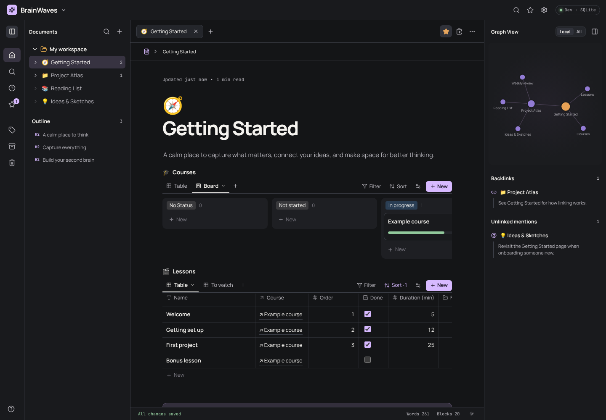
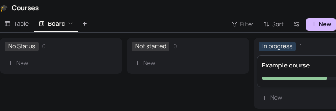
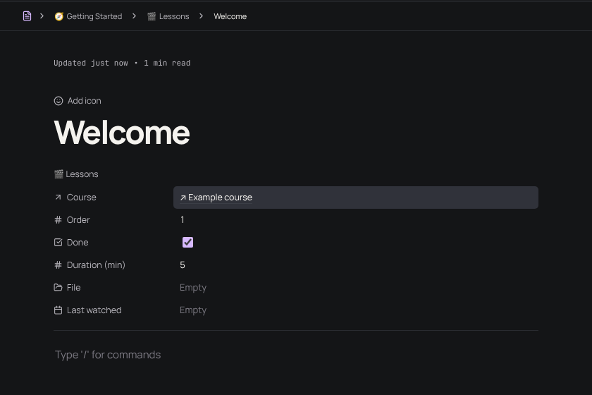

# Phase 3: Databases, relations and rollups (driven by the Course module)

**Status:** working end to end in the browser against the real Rust core.
- **Rust tests:** 27 pass, 5 of them new database tests.
- **JS contract tests:** 3 pass, now including the database block.
- **Typecheck and clippy:** clean.
- **Browser runs:** scripted runs found no console errors.

**Branch:** `claude/dazzling-einstein-0r1sxx`.
**Builds on:** [Phase 2](phase-02-editor.md).
**Plan:** step 3 of the build order in [architecture.md](architecture.md).



*Two inline databases created with `/course`. Courses is shown as a board grouped by status, with
each course's progress bar. Lessons is a table. Ticking "Done" on a lesson updates the course's
progress immediately.*

---

## 1. What this phase had to deliver

You set two priorities:

1. **Relations are essential.** The Course module tracks progress across courses and their lessons.
2. **The Course module decides which column types exist.** A course is a page with properties;
   lessons are rows linked to it.

So the measure of success was concrete. You should be able to:
- create a Courses database and a Lessons database;
- link lessons to a course;
- see the course's **progress update live** when a lesson is ticked.

That works (section 9 lists the tests). Everything else here (views, filters, column menus)
serves that, and it's general: none of it is specific to courses.

---

## 2. The model in one picture

```text
  Database page "Courses"  (page.kind = "database")             Database page "Lessons"
  ┌────────────────────────────────────────────┐                ┌──────────────────────────────────────┐
  │ dbProperties: Name · Status · Folder ·      │                │ dbProperties: Name · Course · Order · │
  │   Lessons(computed) · Progress(rollup) ·... │                │   Done · Duration · File · Watched    │
  │ dbViews: Table · Board                      │                │ dbViews: Table · To watch             │
  └────────────────────────────────────────────┘                └──────────────────────────────────────┘
        ▲ page.database                                                ▲ page.database
  ┌─────┴──────────────┐                                    ┌──────────┴─────────────────────────────┐
  │ Row page "Rust"     │◄─── Course: ["c-rust"] ────────────│ Row page "Ownership"                    │
  │ props:              │     (stored on the lesson only)    │ props: db.order=1  db.done=true          │
  │   db.status="doing" │                                    │        db.minutes=30                     │
  └─────────────────────┘                                    │        db.<course>=["c-rust"]            │
                                                             └──────────────────────────────────────────┘
  Query "Courses":  Lessons = rows whose Course contains "c-rust"   (read backwards from the index)
                    Progress = done lessons / all lessons            (computed, never stored)
```

Five rules, each with a reason:

| Rule | Why |
|---|---|
| **A database is a page.** Its Y.Doc holds `dbProperties` (columns) and `dbViews` (saved views). | It shows up in the sidebar, can be opened, linked with `[[`, trashed and restored like any page, using code that already works. |
| **A row is a page.** `page.database` points at its database; cell values are props `db.<column id>` on the row. | Your architecture doc: *"Don't put a 10,000-row table into one Y.Doc. Give each row its own small doc."* A lesson opens as a full page, with its notes under its properties. |
| **A relation is stored on one side only.** The lesson stores which course it belongs to. | The two sides can never disagree, because there is only one copy of the link. |
| **The other side is computed.** A course's "Lessons" column reads the same links backwards from the index. | Two-way relations without keeping two lists in sync. |
| **Rollups are never stored.** They're calculated each time a view is queried. | They can't go stale, and they work even when no page is open: they're computed in Rust from the index. This is the "declarative layer" from the architecture doc. |

---

## 3. Column types (shaped by the Course module)

| Type | Stored as | Course use |
|---|---|---|
| Title | the row page's title | course / lesson name |
| Text | `"…"` | notes |
| Number | `12` | lesson order, duration in minutes |
| Select | `"option-id"` | course status (Not started / In progress / Finished) |
| Multi-select | `["id", …]` | tags, topics |
| Date | `"2026-10-29"` | last watched |
| Checkbox | `true` (unchecked = no value) | lesson done |
| URL | `"https://…"` | course website |
| **File path** | `"C:/Courses/Rust"` | source folder, video file (new type, for the module's file system work in phase 6) |
| **Relation** | `["row-id", …]` on the stored side | lesson → course |
| **Rollup** | not stored | progress, total minutes, number of lessons |

The core checks every value before writing it (`normalize_value` in `database.rs`):
- `"lots"` in a Number column is rejected, while `" 7 "` is accepted as 7.
- An empty value or an unchecked box clears the cell, so empty cells take no space.
- A rollup can't be written to at all.

**Rollup calculations:**
- Count all, count values.
- **Percent checked** (the progress bar).
- Sum, average, min, max.
- Show values (shows select options by name).

### The Course tracker (`/course`)

This is the data the Course module (phase 6) will build on:

| **Courses** | type | | **Lessons** | type |
|---|---|---|---|---|
| Name | Title | | Name | Title |
| Status | Select | | Course | Relation → Courses |
| Source folder | File path | | Order | Number |
| Lessons | Relation (computed side) | | Done | Checkbox |
| Progress | Rollup: % of Lessons where Done | | Duration (min) | Number |
| Total minutes | Rollup: sum of Duration | | File | File path |
| | | | Last watched | Date |

It also creates:
- **views:** Courses as a table and a board grouped by status; Lessons sorted by order, plus a
  "To watch" view (Done is unchecked);
- **an example course with three lessons**, so the progress bar has something to show.

---

## 4. Relations in detail

**Creating one.** `create_relation(Lessons, {name: "Course", target: Courses, twoWay: true})`
adds a stored column to Lessons. Because it's two-way, it also adds a computed column to Courses.
Each column records its pair (`syncedProperty`), and the computed one is marked `computed: true`.

**Reading the computed side.** The index already holds every row's values as JSON (`props`
table). SQLite's `json_each` reads the lists backwards in one query:

```sql
SELECT j.value AS course, p.block_id AS lesson
FROM props p, json_each(p.value) j JOIN page_meta m ON m.id = p.block_id
WHERE p.key = 'db.<course column>' AND m.trashed_at IS NULL
```

No extra table was needed, so the index projection still depends on each page alone, and
rebuilding stays a pure replay of the log.

**Editing from the computed side.** Picking lessons in a course's "Lessons" cell can't write to
the course, because the course stores nothing. Instead `set_value` adds or removes the course in
each affected *lesson's* list. The test `editing_the_computed_side_rewrites_the_stored_links`
covers this.

**Trash.** Trashed rows drop out of relations and rollups straight away. Restoring them brings
them back, because the links were never removed.

**Removing a relation column** removes its pair in the other database, and every rollup built
on either side. The test caught a bug here: at first, the rollups on the *other* database were
left behind. That's fixed.

---

## 5. Views and the query engine

File: `crates/bw-core/src/db_query.rs`.

A view is saved in the database's doc:
- **type:** table, board or gallery;
- **filters**, all of which must match;
- **sorts:** several levels, each ascending or descending;
- **board grouping:** a Select column;
- **hidden columns.**

`Core::query_database(database, view)` runs it:

```text
1. rows of the database + their stored values        2 SQL queries over the index
2. relations: drop links to trashed rows; fill the computed side (json_each, above)
3. rollups: for each row, look up the related rows' values and calculate
4. filters → sorts → board groups (option order, plus a "No <column>" group first)
5. return rows + titles of every related row (so cells show names, not ids)
```

- **Filters:** is / is not / contains / does not contain / greater than / less than / is empty /
  is not empty. They work on every type, including relations ("Course is Rust") and rollups
  ("Progress greater than 0.5").
- **Sorting:** empty cells always go last; selects sort in option order, not alphabetically.
- **Board grouping:** dragging a card to another column sets the Select value.
- **Hidden columns, not shown ones.** A view stores which columns it hides, so a column you add
  later appears in every view. The browser test caught this: the first version stored *shown*
  columns, so new columns were invisible in the template's views.

**Speed.** Rows are filtered and sorted in Rust after two indexed SQL queries. For a course
catalogue (hundreds to a few thousand rows) that's milliseconds. If a database ever reaches tens
of thousands of rows, simple filters can be pushed down into SQL without changing the API.

---

## 6. Changes to the index

- `page_meta` gained two columns: `kind` (page or database) and `database_id` (set on rows),
  with an index on `database_id`.
- **Index versioning.** The index now records its version (`INDEX_VERSION = 3`). If you open a
  workspace whose index was written by an older build, the core drops the index and rebuilds it
  from the update log. No data is lost, because the log is the truth. The test
  `rows_are_pages_and_the_index_rebuilds` simulates an old index and checks that the same query
  results come back.

---

## 7. The UI

Files: `apps/desktop/src/database/`.

| File | What it does |
|---|---|
| `DatabaseView.tsx` | View tabs, filter/sort/settings menus, New button, and the table, board and gallery views. Also `RowProperties`, the values shown at the top of a row page. |
| `cells.tsx` | One cell per column type, edited in place. Select pickers create options as you type. Relation pickers search the other database and can create a row in it. |
| `menus.tsx` | Add a column (with relation and rollup setup), edit a column (rename, retype, options, hide, delete), filters, sorts, view settings. |
| `useDatabase.ts` | Runs a view and re-runs it whenever the core reports a change, so every open view of a database stays live. |
| `templates.ts` | The Course tracker. |

Where databases appear:
- **Full page:** opening a database page shows the database instead of text.
- **Inline:** `/database` in any page creates a database as a sub-page and shows it right there.
  The block remembers which view you picked.
- **Linked:** `/database page` creates a database page and links to it.
- **Rows:** opening a row shows its values above its notes. Every value is editable there, and
  there's a link back to its database. Rows stay out of the sidebar tree and the graph, so a
  database with 300 lessons doesn't flood the sidebar.

Three smaller fixes came out of browser testing:
- **Checkbox lag.** Checkboxes now update instantly instead of waiting for the core.
- **Blocked shortcuts.** Keyboard shortcuts were blocked while focus was inside a database.
- **Unlabelled numbers.** Numbers on cards had no label.

---

## 8. API commands (bw-api)

| Command | Purpose |
|---|---|
| `createDatabase` | Create a database page with a Name column and a Table view. |
| `databaseDef` | Return a database's columns and views. |
| `queryDatabase` | Run a view, or an unsaved one passed in. |
| `setProperty` | Add or change a column. |
| `createRelation` | Create a relation column (optionally two-way). |
| `removeProperty` | Remove a column (and its pair and dependent rollups). |
| `setView` / `removeView` | Save or delete a view. |
| `createRow` | Add a row with optional values. |
| `setValue` | Set one cell. |

---

## 9. Testing done

**Rust** (`crates/bw-core/tests/databases.rs`, built around the Course tracker):

- **`progress_is_a_live_rollup_over_a_two_way_relation`:**
  - progress starts at 50%;
  - ticking a lesson gives 75%;
  - trashing a lesson gives 100%;
  - total minutes is a sum and the lesson count is a count;
  - a course with no lessons shows an empty progress (not 0%).
- **`editing_the_computed_side_rewrites_the_stored_links`.**
- **`views_filter_sort_and_group`:** filters on checkbox, number, text, relation and empty cells;
  sort descending; board groups in option order.
- **`values_are_checked_and_columns_guarded`:** wrong value types are rejected, and the title and
  relation columns are protected. Removing a relation removes its pair and rollups.
- **`rows_are_pages_and_the_index_rebuilds`:** the rebuilt index equals the live index, and an
  index from an older version is rebuilt on open.

**Contract:** a `database` block written by Rust loads in Tiptap unchanged, and one written by
Tiptap is read correctly by Rust.

**In the browser, against the dev server, with no console errors:**
- `/course` builds both databases, and the example course shows 67%.
- Ticking a lesson gives 100%. Adding a new lesson and linking it through the relation picker
  gives 75%, and the core reports the same.
- The board groups courses by status.
- A lesson opened as a page shows its values with the course link.
- The full-page database works.
- Adding a Number column shows it in the existing view, and typing 4.5 saves.
- A relation created through the UI works, and a filter shows "1 row hidden by filters".
- Gallery view, plain `/database`, and Ctrl+N from inside a database all work.

| Board | A lesson opened as a page |
|---|---|
|  |  |

---

## 10. Known limits

1. **No formulas yet.** Rollups cover progress tracking. Formulas would be the next declarative piece.
2. **Rollups can't use a computed column** of the other database (a rollup of a rollup, or of
   the computed side of a relation). The query shows them as empty rather than guessing.
3. **Cell values are last-writer-wins.** If two devices edit the *same cell* at the same moment,
   one edit wins. That includes the same lesson's relation list. Different cells never conflict.
   Text inside a row's notes still merges character by character as before.
4. **Changing a column's type doesn't convert existing values.** Old values stay and display as
   best they can.
5. **No manual ordering yet.** Rows can't be dragged to reorder; their order is creation order
   or the view's sort. Columns can't be dragged either: their order is shared by all views.
   Board cards move between columns, not within one.
6. **Filters are all-AND.** There are no OR groups yet.
7. **A database page shows only the database**, with no text above it. Its title and icon are
   edited like any page's.
8. **"Duplicate page" on a database page** copies its text but not its columns or rows.
9. **File paths are text for now.** Opening the file or folder from BrainWaves needs the module
   capability host (phase 6), which is where the Course module's file access belongs.

## 11. What comes next

The build order continues with **phase 4: the widget data API**. Most of it already exists:
- `queryDatabase` + core events is `db.subscribe(query, cb)`;
- `setValue` / `createRow` is `db.mutate(rowId, patch)`.

What remains is the widget packaging and the per-widget access declarations.
