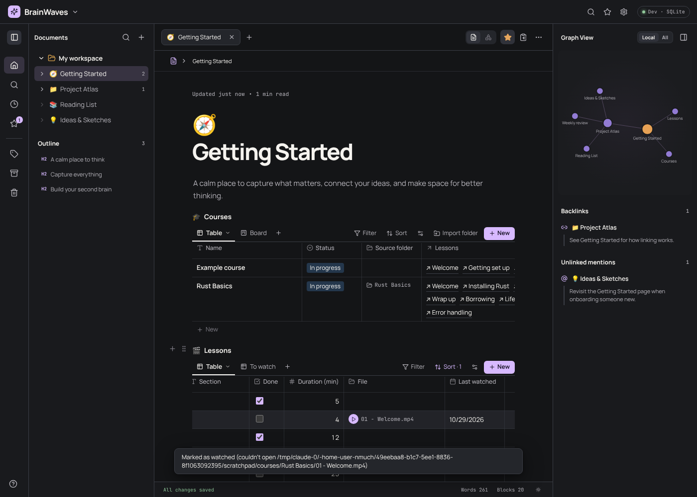
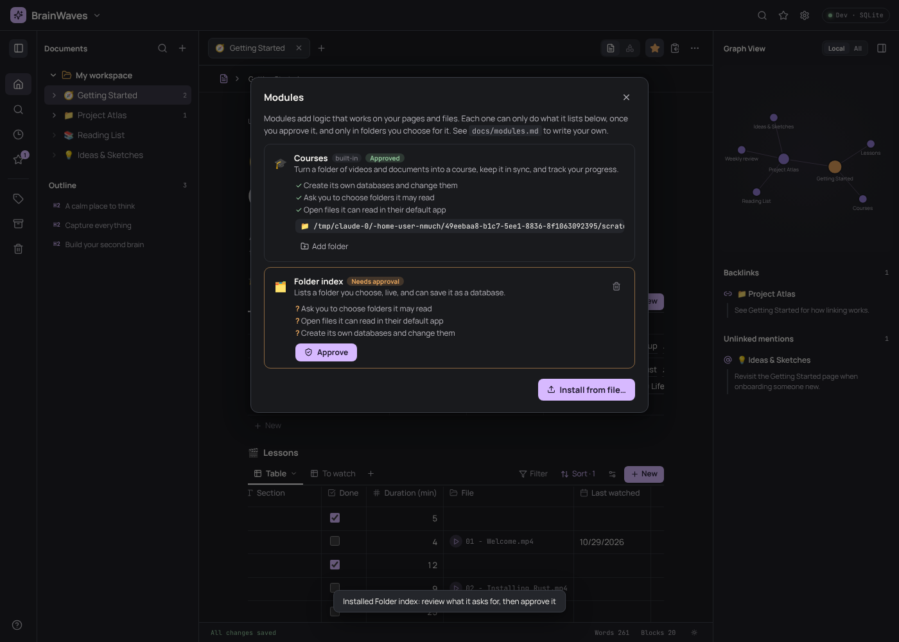
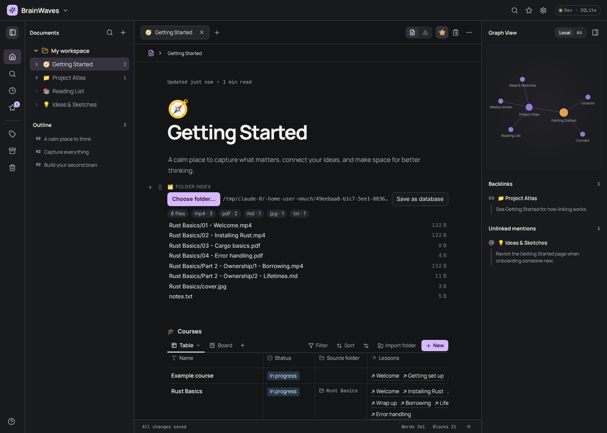

# Phase 6: The module capability host and the Course module

**Status:** working end to end in the browser against the real Rust core, with a real course
folder and the folder watcher running.

| Check | Result |
|---|---|
| Rust tests | 44 pass, including 8 new: 4 for the capability host, 4 for the Course module |
| JS contract tests | 3 pass |
| Typecheck and clippy | Clean; the desktop app builds with the new folder dialog |

**Branch:** `claude/dazzling-einstein-0r1sxx`.
**Builds on:** [Phase 5](phase-05-edgeless.md).
**Plan:** step 6 of the build order in [architecture.md](architecture.md).

**Writing a module?** [modules.md](modules.md) is the authoring guide.



*"Rust Basics" was imported from a folder. Its lessons come from the files on disk. Opening
"Welcome" (▶ in the File column) set *Last watched* and moved the course to *In progress*.*

---

## 1. What you decided

| Question | Your answer |
|---|---|
| What the Course module does with files | **Import a folder, keep it in sync (watch), open and track lessons.** No moving or renaming files. |
| Which files are lessons | **Videos and documents.** |
| Third-party modules | **Yes, sandboxed**, with capabilities you approve once. |

---

## 2. The capability host

From the architecture doc:

> Manifest declares capabilities, approved once by the user. System code runs in Rust, exposed
> as primitives. Modules never get raw native access.

This is how it works now (`crates/bw-core/src/modules.rs`):

```
 module (manifest: capabilities)        user                       core (checks every call)
 ───────────────────────────────        ────                       ────────────────────────
 "db.own", "fs.pick", "fs.open"   ──►  Approve      ──►  module_grants: capability rows
 bw.fs.pickFolder()               ──►  picks a folder ─►  module_grants: folder row (real path)
 bw.fs.list(p) / readText / open  ─────────────────────►  p resolved (.., links) ⊂ a granted folder?
 bw.db.create / query / createRow ─────────────────────►  owned by this module (db.own)? db.read/write?
 bw.props.set({ "ns.key": … })    ─────────────────────►  key in the module's namespace?
```

**The capabilities:**
- `db.own`, `db.read`, `db.write`
- `fs.pick`, `fs.read:<path>`, `fs.open`

Each is shown to the user in plain words. **An update that asks for more needs approval
again.** Approvals and folders are app data, kept in the `modules` and `module_grants` tables
next to `widget_defs`. They're not in the Yjs log, because they aren't page content.

**Folders are checked by their real path.** A path is resolved first (`..` and symbolic links),
then it must be inside a granted folder. The tests try both kinds of escape, and the browser run
tries `courses/../other/secret.txt`: all are refused.

### Watching folders

The host (desktop app or dev server) runs a watcher thread (`crates/bw-api/src/watch.rs`):

- **Which folders:** the core decides, from `watch_roots()`: every folder of every approved
  module. A counter tells the watcher when that list changes, so a newly picked folder is
  watched at once.
- **When things change**, it waits for a quiet 0.7 s, then:
  - re-syncs the courses in that folder;
  - emits `fsChanged`, which the frontend passes to the module that owns the folder.
- **At startup** it syncs every course once, because folders change while the app is closed
  too.

---

## 3. The Course module

The Course module is first-party Rust (`crates/bw-core/src/course.rs`), held to the same checks:
- Its manifest is `db.own`, `fs.pick` and `fs.open`.
- Its capabilities are approved with the app, but **you still choose its folders**.

| Action | What happens |
|---|---|
| **Setup** (`/course`) | Creates **Courses**:<br>• Status, Source folder, Lessons, Progress, Total minutes<br>• a Board view<br><br>Creates **Lessons**:<br>• Course, Order, **Section**, Done, Duration, File, Last watched, **Missing**<br>• a "To watch" view<br><br>The databases are owned by the module. |
| **Import folder** (button on Courses) | Choose a folder; it becomes the module's to read. One lesson per video (mp4, m4v, mkv, webm, mov, avi) or document (pdf, ppt/pptx, key, md, txt, html, doc/docx, epub). Details below. Importing the same folder again adds nothing twice. |
| **Sync** (automatic, or **Sync with folder** on a course's page) | New files become lessons, and the Order of every lesson is refreshed. Lessons whose file is gone get **Missing**: they're **never deleted**, so your ticks and notes stay. A file that comes back clears Missing. If the whole folder is gone (an unplugged drive), nothing is flagged. |
| **Open lesson** (▶ in the File column, or **Open lesson** on its page) | The core checks the file is inside a folder you gave the module, then sets *Last watched* to today and moves a *Not started* course to *In progress*. The host opens the file in its app. |

**How an import names and orders lessons:**
- **Order:** natural order, so `2 - …` comes before `10 - …`.
- **Section:** the subfolder.
- **Duration:** read from the MP4/MOV header (no ffmpeg needed).
- **Title:** cleaned up: `01 - Getting_started.mp4` becomes "Getting started", and `2b - Extra`
  becomes "Extra". `3D printing` keeps its 3, because a number is only stripped when a
  separator follows it.
- **Skipped:** images, subtitles and hidden files.

**Everything the module stores is ordinary, editable data**: rows, columns, and a few `course.*`
props that tie them to disk (the course's folder, and each lesson's path inside it). "A course is
just a page with extra properties" still holds.

---

## 4. Third-party modules

A third-party module is one HTML file with a manifest, installed from **Settings → Modules →
Install from file…**. It runs in the same sandbox as widgets: scripts only, no network, no
access to the app. You place it in a page with `/` and its name; that block is its user interface.



*Courses is built in and approved, and has one folder. Folder index has just been installed: it
lists what it will be able to do, and does nothing until approved.*



*The example module, [`folder-index.html`](examples/folder-index.html), after approval and
choosing a folder. It lists the folder live (`notes.txt` appeared while it was open), and **Save as
database** creates a database it owns, with a row per file.*

---

## 5. What changed, file by file

**Core (`crates/bw-core`)**
- **`modules.rs` (new):** manifests and capabilities, approvals and folders, plus the checked
  primitives:
  - files: `fs_list`, `fs_read_text`, `fs_open_check`;
  - databases: `module_create_database`, `module_query`, `module_create_row`, `module_set_value`, `module_set_property`;
  - props: `module_props`, `module_set_props`;
  - watching: `watch_roots`, `notify_fs_changed`.
- **`course.rs` (new):** setup, scan, import, sync, open; natural ordering, title cleanup, the
  MP4 duration reader.
- **`store.rs`:** the `modules` and `module_grants` tables.
- **`events.rs`:** `FsChanged`.
- **`core.rs`:** registers the Course module at startup.

**API and hosts**
- **`bw-api/src/modules_api.rs`:** registry and approval commands, course commands, and
  `moduleCall` (what sandboxed modules reach).
- **`bw-api/src/watch.rs`:** the folder watcher (the `notify` crate).
- **Desktop:** a `pick_folder` command (Tauri dialog plugin). The core is now shared with the
  watcher thread.
- **Dev server:** the watcher; `BW_NO_OPEN=1` skips opening files (for headless test runs).

**App (`apps/desktop/src/modules/`, new)**
- `api.ts`: commands, the folder picker (the system dialog in the desktop app, a typed path in a browser), and caches.
- `course.ts`: import, open lesson, sync.
- `ModuleBlock.tsx`: the sandbox, its `bw` client and the bridge. A module's block is a `widget`
  block with `module:<id>`, so the editor needed no change.
- `ModulesDialog.tsx`: Settings → Modules.
- **Elsewhere in the app:**
  - Database views get **Import folder**.
  - File cells get ▶ (open) and a **missing** flag.
  - Row pages get **Open lesson** and **Sync with folder**.
  - `/course` now calls the core's setup.

---

## 6. Tests

**Rust**

| Test | What it proves |
|---|---|
| `modules::nothing_works_until_approved_and_only_in_given_folders` | **Nothing before approval.** After approval it lists only the given folder, without hidden files. **These are refused:** another folder, `../`, a symbolic link pointing out, and another module's folder. Revoking stops everything, and re-approving doesn't bring the folders back. |
| `modules::opening_files_needs_fs_open_and_fixed_paths_need_approval` | `fs.read:<path>` works only once approved. `fs.open` and `fs.pick` are separate capabilities. |
| `modules::modules_reach_their_own_databases_and_namespace` | `db.own` reaches only its own databases. Writing to someone else's row is refused. Props outside the module's namespace (including `module.owner`) are refused. `db.read` allows reading, not writing. |
| `modules::manifests_are_checked_and_builtins_are_protected` | Unknown capabilities, reserved namespaces and bad ids are refused. The Course module can't be replaced or removed. An update that asks for more needs approval again. |
| `course::a_folder_becomes_a_course_in_natural_order` | Nothing is read before the folder is given. Lessons come in natural order, with titles, section and duration. Re-importing adds nothing. |
| `course::sync_adds_new_files_and_flags_missing_ones_without_losing_progress` | A new file is added and orders are refreshed. A gone file is flagged, a returned file unflagged, and its Done tick is kept. The watcher entry point finds the course. A vanished folder flags nothing. |
| `course::opening_a_lesson_marks_it_watched_and_starts_the_course` | Opening sets Last watched and In progress. A lesson pointed at a file outside the folder is refused. |
| `course::names_and_order` | Title cleanup, natural sort, the MP4 duration reader. |

**Browser (scripted, against the dev server, with the watcher running)**
1. `/course`, then **Import folder** "Rust Basics": "6 new lessons". The order was Welcome,
   Installing Rust, Cargo basics, Wrap up (`10 - …` after `03 - …`), then Borrowing and
   Lifetimes in section "Part 2 - Ownership". Durations were 4, 9, 5 and 21 min; `cover.jpg` was
   skipped.
2. **Changed the folder on disk** (no click in the app): a new PDF became a lesson, and a moved
   video was flagged *missing*.
3. ▶ on "Welcome": Last watched became today, and the course moved to In progress.
4. **Settings → Modules:** Courses is built in, approved, with its folder. Installed
   `folder-index.html`: **Needs approval**.
5. `/folder`: the block asked for approval, and an API call made before approving was refused.
   Approved, chose a folder: it listed 7 files. Wrote a file on disk: **8 files**, live.
6. **From inside the sandbox, all refused:**
   - reading `other/secret.txt`, both directly and through `..`;
   - querying a database it doesn't own;
   - setting a `course.*` prop.
7. **Save as database:** a "Files in courses" database owned by the module, with 8 rows, opened.
8. **Revoke:** its next call was refused.

**Bugs found and fixed while testing:**
- **A missing database leaked that it was missing.** Asking for a database id that doesn't exist
  answered "page not found", not "not allowed", which would let a module probe for page ids. It
  now answers like any other refusal.
- **Pages a module just created didn't open.** The app's page list catches up a moment later,
  so the open now waits for the page to appear.
- **Lesson titles lost or kept the wrong numbers.** "2b - Extra" kept a stray "b", and "3D
  printing" lost its 3. Numbering is now only stripped when a separator follows it.

---

## 7. Limits and next steps

- **No file operations** (move, copy, rename) yet, as decided. The planned `fs.write` capability,
  with a logged, undoable file-operation trail, fits the same host.
- **Renamed files** show up as one missing lesson plus one new lesson. Matching them by size and
  name would keep the lesson's ticks and notes.
- **Durations** are read for MP4, M4V and MOV only. MKV, WebM and AVI need a container parser.
- **Third-party modules run only while their block is on screen.** Background automation
  ("when a row is added in X, create one in Y") needs a module runtime that isn't tied to a page
  being open.
