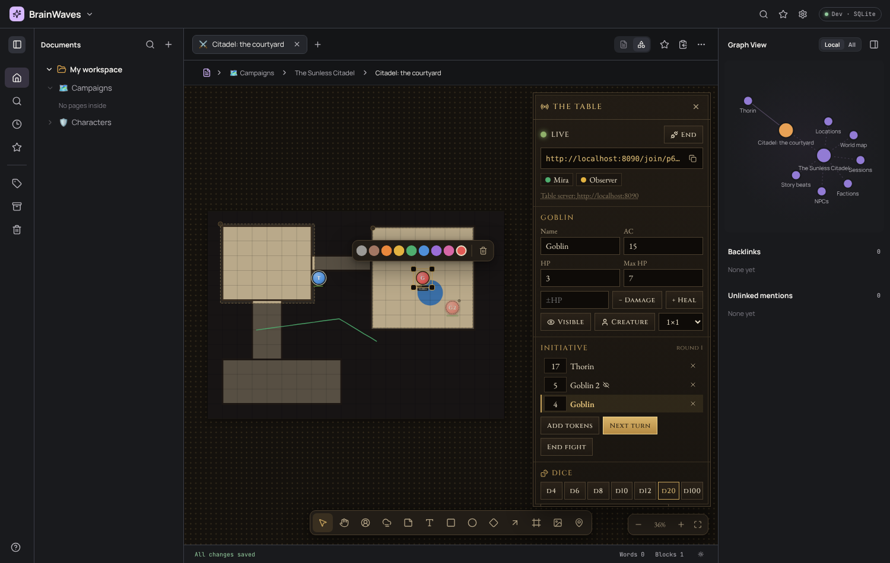
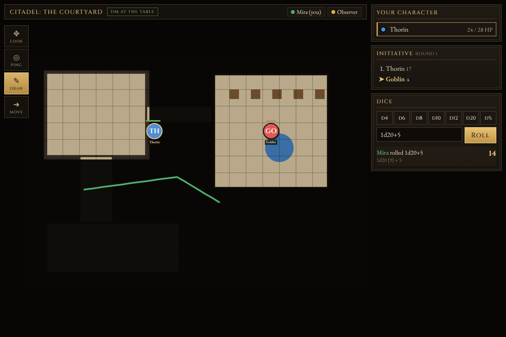
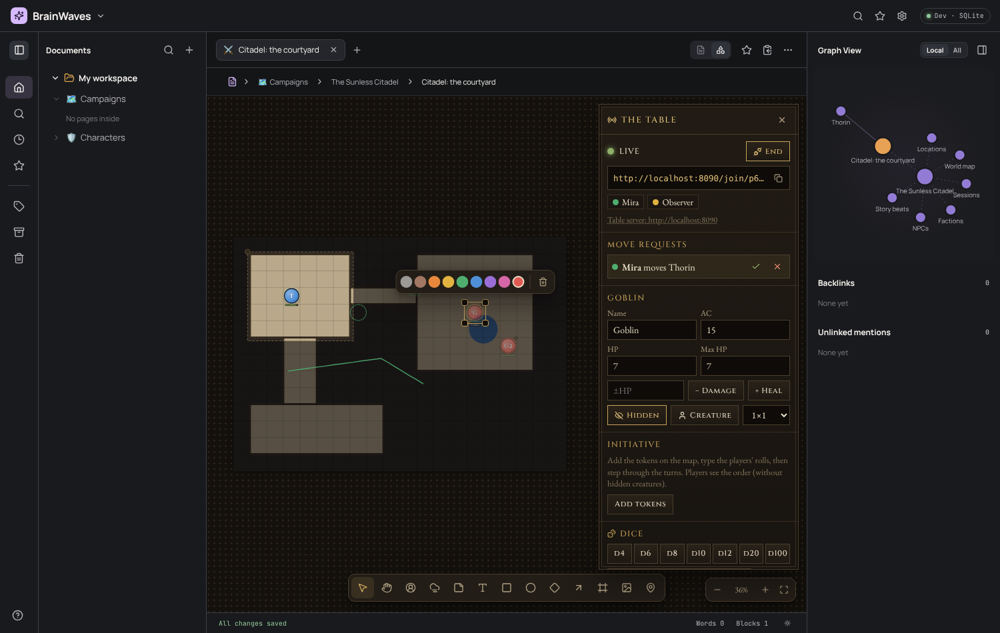

# The table: battle maps your players join

BrainWaves is where you, the DM, prepare and run a fight: the dungeon picture, the grid, who
stands where, what's still hidden in the fog. **The table** is a small server you run on your
home server. Players open its link in any browser (laptop, tablet, phone) and see the battle map
live, with only what you've revealed.





What players can do at the table:

- **Look**: pan and zoom the map (drag, wheel, or pinch).
- **Ping** a spot: a ring flashes there for everyone, you included.
- **Draw** on the map for a few seconds: show a route, mark a door.
- **Move** their own character. They drag it to where it should go, and the move waits for you.
  You accept it (the token moves, snapped to the grid) or decline it.
- **Roll dice**: d4 to d100, or anything like `2d6+3`, `d20 adv`, `4d6kh3`. Everyone sees
  the rolls.
- See their character's hit points, the initiative order, and who else is at the table.

They can't see hidden tokens, creatures standing in the fog, monsters' hit points (only
*bloodied* or *down*), your notes, or anything else in BrainWaves. BrainWaves decides what to
send, so nothing hidden reaches the server.

## 1. Run the table on your home server (Docker)

On the server, from a copy of this repository:

```sh
cd deploy/table
echo "BW_TABLE_DM_KEY=$(openssl rand -hex 16)" > .env   # your DM key: keep it to yourself
docker compose up -d --build
docker compose logs table                             # shows the address and the DM key
```

The table listens on port **8090**. Rooms and map pictures live in the `table-data` Docker
volume, so they survive restarts and upgrades. To upgrade, `git pull` and run
`docker compose up -d --build` again.

Without Docker, build and run it directly:

```sh
cargo build --release -p bw-table
BW_TABLE_DM_KEY=your-long-key BW_TABLE_DATA=/srv/table ./target/release/bw-table
```

| Setting | Default | |
| --- | --- | --- |
| `BW_TABLE_PORT` | `8090` | The port. |
| `BW_TABLE_DATA` | `table-data` (Docker: `/data`) | Rooms (`rooms/<code>.json`) and their pictures. |
| `BW_TABLE_DM_KEY` | generated | The key BrainWaves uses to open rooms and run them (8+ characters). If unset, one is made, saved in `dm-key.txt` in the data folder, and printed at startup. |

Check it's running: `http://<server>:8090/health` answers `ok`.

## 2. Make a battle map

1. Open a campaign. In **Battle maps**, click **+ Battle map**. It opens as a canvas.
2. Put the dungeon on it: the **Image** tool (`I`), then click where it goes. Battle maps keep
   the picture at its own size and on the grid, so a map drawn at 70 px per square lines up
   with the default grid.
3. In the panel on the right (**The table**), under **Map**, set the square size to your
   picture's squares. Nudge **Shift x / y** until the grid lines sit on the picture's lines.
   Set the feet per square (5 by default).
4. Place tokens with the **Token** tool (`K`), then click where the creature stands:
   - **Party**: your characters, with their hit points and AC from their sheets. These are
     the tokens players can claim and move.
   - **Monster**: anything from your 5etools compendium. It gets its average hit points, its
     AC and its size (large creatures take 2×2 squares, and so on).
   - **Other**: a name, hit points and a size, for anything else.

   Monsters start **hidden** (dashed and see-through for you, absent for players). Select a
   token and click **Hidden / Visible** to show it.
5. **Fog of war** is on by default: players see only the areas you clear. Use the **Reveal**
   tool (`E`) to drag over a room. Each cleared area has a small ◌ handle: drag it to move the
   area, or select it and press Delete to fog it again. **Reveal all** and **Fog all** are in
   the panel.

Tokens snap to the grid when you drop them. Select one to edit its name, AC and hit points, or
type a number in **±HP** and press **Damage** or **Heal**. You can also change its size, and
whether it's a player character or a creature.

## 3. Go live

The first time, the panel asks for your table server: its address (for example
`http://192.168.1.20:8090`) and the DM key. BrainWaves keeps them in this workspace.

Click **Go live**. BrainWaves makes a room for this battle map, and the panel shows its join
link. Copy it (⧉) and send it to your players. They type a name, take a seat, and click their
character under **Your character**.

While you're live:

- Every change on the map (a token moved, an area revealed, hit points) reaches the players
  within a moment.
- **Move requests** appear in the panel, and as a dashed ghost on the map where the player wants
  to go. ✓ moves the token, ✕ declines. Each player has one open request at a time.
- Players' pings and drawings show on your map too. **Alt-click** the map to ping for
  everyone.
- **Initiative**: **Add tokens** puts every token on the map in the list (monsters get a
  rolled d20). Type the players' rolls, and the list sorts. **Next turn** moves the marker and
  counts rounds. Players see the order without hidden creatures.
- **Dice**: your rolls are **secret** by default (only you see them). Untick *secret* to roll
  in the open.



**End** closes your connection; the room stays, so **Go live** later re-opens the same room with
the same link. Players who stay connected see "DM away" in the meantime.

## 4. Reaching the table from outside your home

On your home network, players use your server's LAN address. For players elsewhere, put the
table behind something that gives it a public **https** address:

- **Tailscale** (players join your tailnet, or use Tailscale Funnel), or
- **Cloudflare Tunnel** (`cloudflared tunnel --url http://localhost:8090`), or
- your reverse proxy (Caddy, nginx, Traefik) with a certificate. Forward WebSocket upgrades
  for `/ws/`.

Then use the https address in BrainWaves too. The links and the live connection follow it
(`wss://` for the live link).

> If BrainWaves can't reach the server, the panel says so. Check the address, that port 8090
> is open on the server's firewall, and the DM key. A wrong key shows "The table server refused
> the DM key."

## 5. How it's built

```
BrainWaves (the DM)                          bw-table (your home server)            players' browsers
──────────────────                          ────────────────────────────            ─────────────────
battle map page (a canvas)                   POST /api/rooms  (Bearer DM key)
  tokens, reveals, image  ── projection ──▶  /ws/<code>?key=…  ── scene ──────────▶  /join/<code>
  dnd.scene: grid, fog,      (only what                         ◀─ ping, draw,       canvas page
  room, initiative            players may see)                     move, roll, claim
                          ◀── requests, pings, rolls, players ──
```

- **The battle map** is an ordinary BrainWaves page with the D&D role `scene`, under its
  campaign. Tokens (`token`) and cleared areas (`reveal`) are canvas elements in the page,
  with the map picture (`image`), so they sync, undo and back up like everything else
  (`crates/bw-core/src/surface.rs`). The grid, fog switch, room code and initiative are the
  page's `dnd.scene` property (`crates/bw-core/src/dnd.rs`).
- **What players see** is computed in BrainWaves (`apps/desktop/src/dnd/live.ts`, `project`).
  It includes the largest picture, the grid, the cleared areas, and tokens that aren't hidden.
  Player characters are always included; other tokens only when their center is in a cleared
  area. Hit points are sent for player characters only, and monsters get a status instead. The
  initiative leaves out tokens players can't see. The picture is sent once (by its SHA-256);
  the rest is re-sent shortly after each change.
- **The server** (`crates/bw-table`, Rust: axum and tokio) relays and remembers. It keeps
  each room's last scene, its pictures (the last 6) and its last 60 rolls on disk, and it rolls
  the dice itself so nobody can fake a roll. Only someone with the DM key can open rooms, send
  scenes and answer move requests. Players can only claim and request moves for player
  characters, and the server limits each connection to 20 messages a second.
- **The player page** (`apps/table`) is plain HTML, CSS and JavaScript served by the table
  server itself, in the same campaign look (Cinzel and EB Garamond, bundled under the SIL Open
  Font License).

### The protocol

JSON messages over the WebSocket `/ws/<code>?key=<DM key or empty>&name=<name>`.

| From | Message | |
| --- | --- | --- |
| DM | `{t:"scene", scene}` | The player-safe scene (stored, sent to players). |
| DM | `{t:"image", hash, data}` | A map picture as a data URL; players fetch `/api/rooms/<code>/image/<hash>`. |
| DM | `{t:"decide", id, accept}` | Answer a move request. |
| player | `{t:"claim", token}` | "This one's me" (player characters only). |
| player | `{t:"move", token, x, y}` | Ask to move their character (x, y: the token's new center). |
| anyone | `{t:"ping", x, y}` / `{t:"draw", points}` | A ping, or a drawing that fades after 8 seconds. |
| anyone | `{t:"roll", expr, label?, private?}` | Roll dice (`private` only for the DM). |
| server | `welcome`, `scene`, `players`, `dm`, `ping`, `draw`, `roll`, `request` (DM only), `pending`, `decided`, `error` | |

### Tests

- `cargo test -p bw-table`: the dice roller; a DM and players over real WebSockets (claims,
  move requests, decisions, pings, rolls, the DM key); pictures and persistence
  across a restart.
- `cargo test -p bw-core --test dnd`: battle map pages, scene settings, token and reveal
  validation.
- End to end (Playwright, a DM in BrainWaves and a player in a second browser) for a battle map,
  tokens from the party and the compendium, fog, going live, a move request accepted, pings and
  drawings, hit points, initiative and dice. It also checks that a hidden creature never reaches
  the server.

### Limits and next steps

- One picture per battle map is sent to players (the largest); other images stay with you.
- Cleared areas are rectangles (the format also takes polygons, for a future freehand tool).
- No dynamic lighting, line of sight or walls, measurement, or area templates yet.
- Players can't move NPCs or monsters; the DM moves everything else.
- Hit point changes on a player character's token aren't written back to the character
  sheet.
