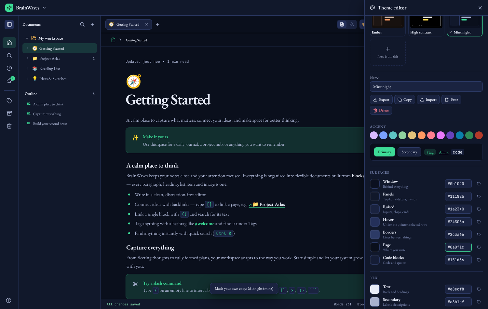
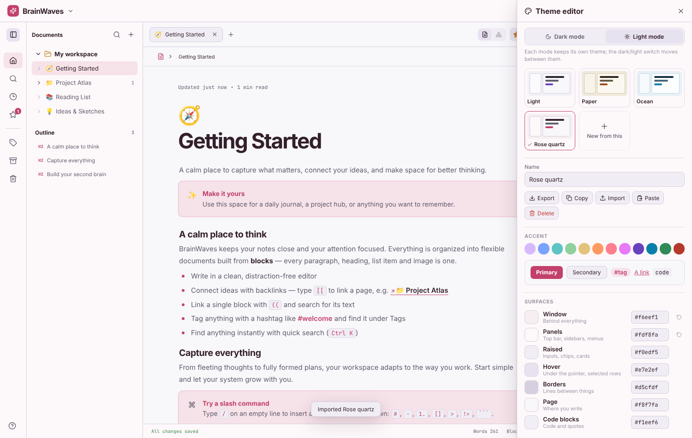

# Themes

The theme editor restyles the whole app as you edit it: the app itself is the preview. Open it
from **Settings → Theme editor…** or the app menu (BrainWaves ▾ → **Theme editor**).



## Picking and making themes

- **Each mode keeps its own theme.** Pick one for **Dark mode** and one for **Light mode**; the
  usual dark/light switch moves between them.
- **Built-in themes:** Dark and Light (BrainWaves' own), Midnight, Forest, Ember and High
  contrast (dark), Paper and Ocean (light).
- **Changing a built-in theme makes your own copy** ("Midnight (mine)"), so the originals are
  always there. **New from this** starts a copy on purpose. Rename your themes in **Name**.
- **Colors** come in three groups:
  - **Surfaces:** window, panels, raised things, hover, borders, the page, code blocks.
  - **Text:** body text, secondary, faint.
  - **Accent and status:** accent, warm, folders, success, danger.

  Click a swatch for a color picker, or type a `#hex`. ↺ puts one color back. A row of ready
  accents is at the top.
- **Everything else follows** from those colors: soft borders, the accent's tints, the
  selection, and whether text on accent buttons is light or dark (whichever reads better).
- **Fonts:** the interface and writing font (Manrope, System, Humanist, EB Garamond, Cinzel,
  monospace, or any font installed on your computer by name) and the code font.
- **Readability** checks the contrast of text on the page and panels, secondary and faint
  text, the accent, and text on accent buttons, against the WCAG AA levels. A low one is
  marked in red.



## Sharing themes

**Export** saves the theme as a `.bwtheme.json` file and **Copy** puts it on the clipboard.
**Import** and **Paste** bring one in. An imported theme only needs some of its colors; the rest
come from its base (dark or light).

```json
{
  "format": "brainwaves-theme",
  "version": 1,
  "name": "Rose quartz",
  "base": "light",
  "colors": { "appBg": "#f6eef1", "panel": "#fdf8fa", "accent": "#c2416b", "foreground": "#33202a" },
  "fonts": { "sans": "system", "mono": "jetbrains" }
}
```

Color keys: `appBg`, `panel`, `panel2`, `hover`, `line`, `editorBg`, `codeBg`, `foreground`,
`muted`, `faint`, `accent`, `warm`, `folder`, `ok`, `danger`. Font ids: `manrope`, `system`,
`humanist`, `serif`, `classic`, `mono` (code: `jetbrains`, `system-mono`), or a font's name.

## How it's built

- `apps/desktop/src/theme/themes.ts` holds the themes and turns one into the app's CSS variables
  (`--panel`, `--accent`, `--font-sans`, …). It also derives the tints, the text color on the
  accent, and the contrast checks.
- `App.tsx` sets those variables on the workspace (and the window's background), so everything
  styled with them follows, including the graph view, widgets and modules, which get the new
  colors as you edit.
- Your themes and which theme each mode uses are saved with the app's preferences (on this
  computer; export a theme to take it elsewhere).
- Campaign pages keep their own D&D look on top of the theme.
